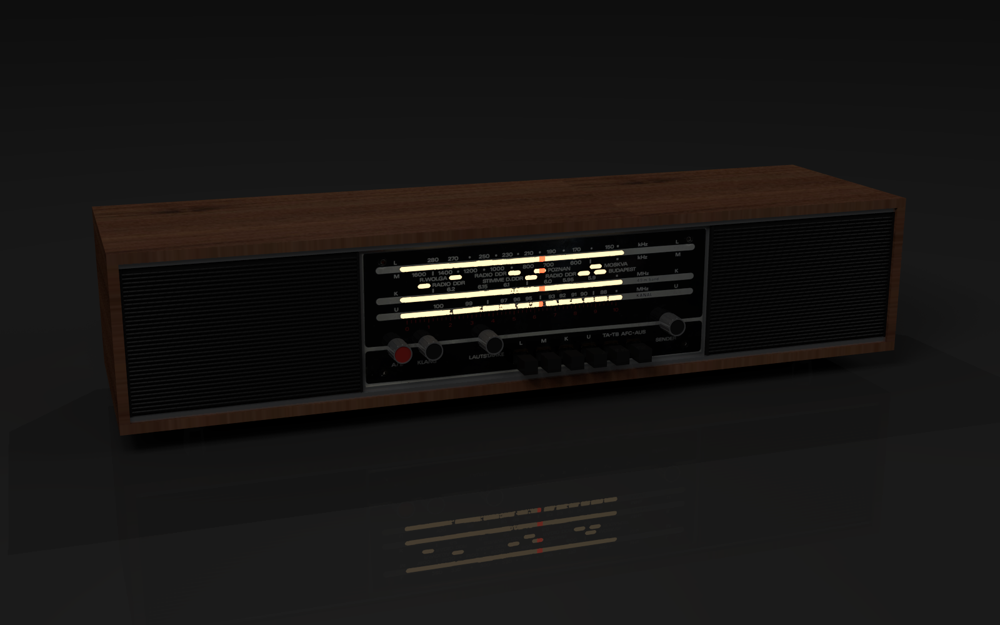

# 3D-Druckteile für das Technikfach

Die Renderings entstehen aus `render/render.py` (POV-Ray) mit dem Dekor Nuss Sizilia und dem entzerrten Foto der Frontplatte. Nachts leuchtet die Skala von hinten, die rote Spalte ist ein LED-Senderzeiger.

| Datei | Inhalt |
|---|---|
| `traeger.scad` | alle Druckteile, Maße oben als Parameter |
| `stl/*.stl` | fertige Druckdateien, schon richtig gedreht |
| `render/render.py` | erzeugt die Renderings neu (`python3 render.py 1600 1000 gut`) |

## Teile

| Teil | Datei | Größe (mm) | Material | Anzahl |
|---|---|---|---|---|
| Träger links (A/E, Klang, Lautstärke) | `traeger_links.stl` | 122 × 53 × 30 | PETG oder PLA, schwarz | 1 |
| Träger rechts (6 Tasten, Sender) | `traeger_rechts.stl` | 180 × 53 × 30 | PETG oder PLA, schwarz | 1 |
| Lichtkasten hinter der Skala | `lichtkasten.stl` | 200 × 56 × 28 | PLA weiß | 1 |
| Halter für Pi mit DigiAMP+ | `pi_halter.stl` | 97 × 68 × 8,5 | PETG oder PLA | 1 |
| Tastenadapter Cherry MX → Taste | `tastenadapter.stl` | 11 × 11 × 8 | PETG oder PLA | 6 (in einer Datei) |

Alle Teile passen auf ein Druckbett von 220 × 220 mm. Die Träger in Schwarz drucken, damit durch die Tasten- und Knopflöcher nichts Helles durchscheint.

**Druckhinweise:**
- **Träger:** liegen mit der Vorderseite auf dem Bett. Nur der Schraubflansch am Rand braucht Stützmaterial.
- **Lichtkasten:** liegt mit dem Diffusor (0,8 mm, also 4 Schichten à 0,2 mm) auf dem Bett. Die Kammern sind nach hinten durch die Rückwand geschlossen, die Brücken sind nur 13 mm lang.
- **Tastenadapter:** stehen auf der Platte, der Stößel mit dem Kreuz zeigt nach oben. Mit 0,12 mm Schichthöhe drucken, damit das Kreuz sauber wird. Wenn es zu stramm sitzt, im Modell das Spiel vergrößern.

## Aufbau hinter der Frontplatte

Maße ab der linken unteren Ecke der Frontplatte (px nach rechts, pz nach oben). Die Lage der Löcher stammt aus deinen Messungen.

| Element | px | pz | Bauteil |
|---|---|---|---|
| A/E | 29 | 33 | Ein/Aus-Schalter (Platz wie ein Drehgeber, siehe offene Fragen) |
| Klang | 54 | 33 | Drehgeber STEC11B (E1) |
| Lautstärke | 104 | 33 | Drehgeber STEC11B (E2) |
| Sender | 264 | 33 | Drehgeber STEC11B (E3) |
| 6 Tasten | 132,5 bis 232,5 (Raster 20) | 13,5 | Cherry MX Blue mit Adapter und Originaltaste |

- **Frontplatte:** wird durch ihre 4 Eckbohrungen (19 mm vom Rand) mit Schrauben 2,5 × 8 direkt an die Frontbretter geschraubt.
- **Träger:** Die beiden Träger sitzen direkt hinter der Frontplatte (0,3 mm Luft). Je ein Flansch wird mit 2 Spax 2,5 × 8 hinten an das Frontbrett geschraubt. In der Mitte verbindet eine Lasche beide Teile, dort kommt eine Schraube 2,5 × 8 von hinten hinein.
- **Drehgeber:** Jeder Drehgeber wird auf ein Stück Lochrasterplatine 20 × 25 mm gelötet. Die Platine wird mit 2 Schrauben M2,5 × 6 an die Säulen des Trägers geschraubt und drückt den Drehgeber dabei gegen den Turm. Die Welle geht durch ein Loch Ø 7 mm. Die Vorderseite des Drehgebers liegt bei y = 18. Bei 20 mm Wellenlänge steckt die Welle damit 9 mm tief im Knopf.
- **Tasten:**
  - Die Cherry-MX-Schalter rasten in eine 1,5 mm dicke Schalterplatte mit 14 × 14 mm Ausschnitten. Die Platte liegt 22,6 mm hinter der Rückseite der Frontplatte.
  - Auf jeden Schalter kommt ein Tastenadapter. Die Originaltaste wird mit Zweikomponentenkleber auf dessen 11 × 11 mm Platte geklebt.
  - Die Taste ragt dann 8 mm vor die Frontplatte und gedrückt noch 4 mm.
  - Der Adapter taucht beim Drücken in den Schalter ein, ohne anzustoßen.
- **Lichtkasten:**
  - Er sitzt über den Trägern direkt hinter der Skala, liegt auf zwei Auflagen und wird mit 2 Schrauben 2,5 × 10 festgeschraubt.
  - Innen hat er 4 Kammern: U-Band, K-Band, Stationsmarken und L-Band. Trennwände verhindern, dass Licht zwischen den Reihen überspricht.
  - Die LED-Streifen kleben innen auf der Rückwand. Das Kabel geht durch den Schlitz rechts hinten.
- **Pi-Halter:**
  - Er liegt auf dem Boden des Technikfachs, wird mit 4 Spax 3 × 10 festgeschraubt und hält den Pi.
  - Der DigiAMP+ (58 × 65 mm) steckt direkt auf dem Pi und wird mit den mitgelieferten Abstandsbolzen auf den vier Pi-Löchern verschraubt. Er braucht deshalb keine eigenen Säulen.
  - Pi auf 6 mm hohen Säulen. Die unteren Schrauben der Abstandsbolzen gehen durch den Pi in die Säulen: M2,5 selbstschneidend oder Gewindeeinsätze M2,5 einschmelzen. Ist die mitgelieferte Schraube zu kurz, eine M2,5 × 12 nehmen.
  - Hohlbuchse und Lautsprecherklemmen des DigiAMP+ sollen zur Rückwand zeigen. Wo genau sie liegen, steht in der Doku nicht; beim Einbau den Pi notfalls um 180° drehen. Die vier Säulen passen auch dann, weil das Lochbild (58 × 49 mm) symmetrisch ist; der Pi steht dann seitlich 21 mm über die Halterplatte hinaus.

## Beleuchtung hinter der Frontplatte

### Was ist durchsichtig?

Aus dem Foto ausgewertet: Die Frontplatte ist durchsichtiger Kunststoff, hinten schwarz und silbern bedruckt. Licht kommt nur an diesen Stellen durch:

| Stelle | Lage (pz) | Größe |
|---|---|---|
| Skalenschlitz L | 94 bis 99,5 | 190 × ca. 5 mm |
| 10 Stationsmarken (zwei Reihen) | 79,5 bis 89 | je ca. 10 × 3 mm |
| Skalenschlitz K (49-m-Band) | 69 bis 74,5 | 190 × ca. 5 mm |
| Skalenschlitz U | 56,5 bis 61,5 | 190 × ca. 5 mm |
| klarer Rand rundum | – | ca. 3 mm |

Die Ziffern und Striche selbst sind gedruckt und lassen kein Licht durch.

### Display: nicht sinnvoll

Ein Bildschirm hinter der Platte wäre nur durch die drei 5 mm hohen Schlitze zu sehen. Ein passendes Display mit 190 mm Breite und 45 mm Höhe gibt es nur als teures Spezialteil. Mehr als leuchtende Streifen würde man trotzdem nicht sehen. Das Gleiche erreicht ein LED-Streifen viel einfacher.

### LED-Lichtkasten: sinnvoll, im Modell schon vorgesehen

Hinter jedem Schlitz liegt eine eigene Kammer mit einem LED-Streifen. Der weiße 0,8-mm-Diffusor vorne verteilt das Licht gleichmäßig, wie die alten Skalenlampen.

- **Streifen:** WS2812B mit 144 LEDs/m und 10 mm Breite. Etwa 4 × 28 LEDs (4 × 194 mm), zusammen 112 LEDs. Einzeln ansteuerbare LEDs können einen **Senderzeiger** darstellen. An der Position des eingestellten Senders leuchtet in allen Reihen eine LED rot, wie der Zeiger früher. Für das aktive Band leuchtet die passende Reihe heller.
- **Ansteuerung:** WS2812B brauchen am Pi einen PWM-, PCM- oder SPI-Pin. Die sind alle schon belegt: GPIO12 durch einen Drehgeber, GPIO18 bis 21 durch den DigiAMP+ (I²S), GPIO10 durch den A/E-Schalter. Am einfachsten ist deshalb ein kleiner Mikrocontroller wie ein RP2040-Zero (ca. 5 €). Er hängt per USB am Pi und bekommt die Zeigerposition als einfache serielle Befehle. Er versorgt die LEDs auch mit 5 V.
- **Strom:** Bei voller Helligkeit in Weiß bräuchten 112 LEDs fast 7 A. Als Hintergrundlicht reichen etwa 10 % Helligkeit, das sind rund 0,4 A und damit kein Problem für den USB-Anschluss. Die Helligkeit in der Firmware begrenzen.
- **Einfachste Variante ohne Zeiger:** warmweißer 5-V-LED-Streifen, über einen MOSFET an GPIO9 gedimmt (GPIO9 ist frei, solange SPI aus bleibt). Dann leuchtet die Skala gleichmäßig wie früher, aber ohne Zeiger.
- **Tasten beleuchten (optional):** Cherry-MX-Schalter haben eine Öffnung für eine 3-mm-LED. Mit durchscheinenden Tastenkappen könnte die gedrückte Bandtaste leuchten. Die Originaltasten sind aber schwarz und undurchsichtig.

## Noch offen

- **Knöpfe:** Für die Befestigung der Originalknöpfe auf der 6-mm-Welle fehlt noch ein Adapter. Dafür brauche ich die Bohrung im Knopf: Durchmesser, Tiefe und ob rund, abgeflacht oder mit Feder.
- **A/E-Schalter:** Der Platz ist wie ein Drehgeber ausgelegt (12 × 12 mm).
- **Wellenlänge der Drehgeber:** Angenommen sind 20 mm ab Vorderseite des Drehgebers. Bei anderer Länge `enc_welle` in `traeger.scad` ändern, Turm und Platine rücken mit.
