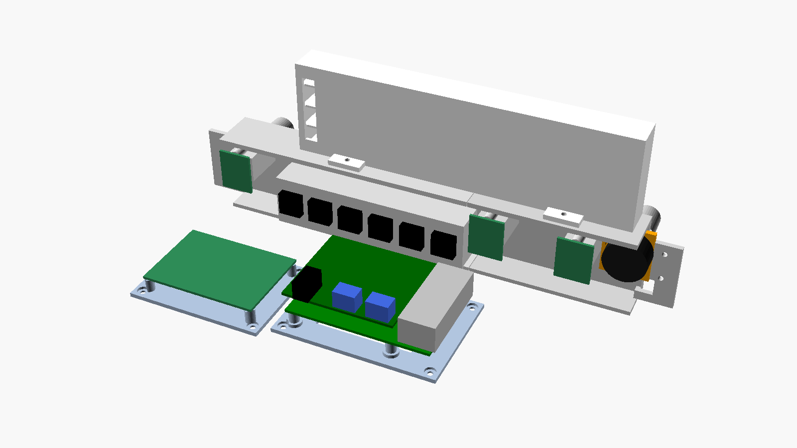

# 3D-Druckteile für das Technikfach

Die Renderings entstehen aus `render/render.py` (POV-Ray) mit dem Dekor Nuss Sizilia und dem entzerrten Foto der Frontplatte. Nachts leuchtet die Skala von hinten, die rote Spalte ist ein LED-Senderzeiger.

| Datei | Inhalt |
|---|---|
| `traeger.scad` | alle Druckteile, Maße oben als Parameter |
| `stl/*.stl` | fertige Druckdateien, schon richtig gedreht |
| `render/render.py` | erzeugt die Renderings neu (`python3 render.py 1600 1000 gut`) |

## Teile

| Teil | Datei | Größe (mm) | Material | Anzahl |
|---|---|---|---|---|
| Träger links (A/E, Klang, Lautstärke) | `traeger_links.stl` | 122 × 53 × 30 | PETG oder PLA, schwarz | 1 |
| Träger rechts (6 Tasten, Sender) | `traeger_rechts.stl` | 180 × 53 × 30 | PETG oder PLA, schwarz | 1 |
| Lichtkasten hinter der Skala | `lichtkasten.stl` | 200 × 56 × 28 | PLA weiß | 1 |
| Halter für Pi mit DigiAMP+ | `pi_halter.stl` | 97 × 68 × 5,5 | PETG oder PLA | 1 |
| Halter für die Steuerplatine | `steuer_halter.stl` | 82 × 62 × 10,5 | PETG oder PLA | 1 |
| Halteplatte Original-A/E-Schalter | `ae_platte.stl` | 28 × 31 × 3 | PETG oder PLA | 1 |
| Kupplung Drehgeber → 3-mm-Stift | `kupplung.stl` | Ø 11 × 16 | PETG | 3 (in einer Datei) |
| Tastenadapter Cherry MX → Taste | `tastenadapter.stl` | 11 × 11 × 8 | PETG oder PLA | 6 (in einer Datei) |

Alle Teile passen auf ein Druckbett von 220 × 220 mm. Die Träger in Schwarz drucken, damit durch die Tasten- und Knopflöcher nichts Helles durchscheint.

**Druckhinweise:**
- **Träger:** liegen mit der Vorderseite auf dem Bett. Nur der Schraubflansch am Rand braucht Stützmaterial.
- **Lichtkasten:** liegt mit dem Diffusor (0,8 mm, also 4 Schichten à 0,2 mm) auf dem Bett. Die Kammern sind nach hinten durch die Rückwand geschlossen, die Brücken sind nur 13 mm lang.
- **Kupplungen:** stehend drucken, 100 % Füllung. Danach die vordere Bohrung mit 3,0 mm und die hintere mit 6,0 mm nachbohren.
- **A/E-Halteplatte:** liegt flach.
- **Tastenadapter:** stehen auf der Platte, der Stößel mit dem Kreuz zeigt nach oben. Mit 0,12 mm Schichthöhe drucken, damit das Kreuz sauber wird. Wenn es zu stramm sitzt, im Modell das Spiel vergrößern.

## Aufbau hinter der Frontplatte

Maße ab der linken unteren Ecke der Frontplatte (px nach rechts, pz nach oben). Die Lage der Löcher stammt aus deinen Messungen.

| Element | px | pz | Bauteil |
|---|---|---|---|
| A/E | 29 | 33 | Original-A/E-Schalter (RFT) auf Halteplatte |
| Klang | 54 | 33 | Drehgeber STEC11B03 mit Kupplung |
| Lautstärke | 104 | 33 | Drehgeber STEC11B03 mit Kupplung |
| Sender | 264 | 33 | Drehgeber STEC11B03 mit Kupplung |
| 6 Tasten | 132,5 bis 232,5 (Raster 20) | 13,5 | Cherry MX Blue mit Adapter und Originaltaste |

- **Frontplatte:** wird durch ihre 4 Eckbohrungen (19 mm vom Rand) mit Schrauben 2,5 × 8 direkt an die Frontbretter geschraubt.
- **Träger:** Die beiden Träger sitzen direkt hinter der Frontplatte (0,3 mm Luft). Je ein Flansch wird mit 2 Spax 2,5 × 8 hinten an das Frontbrett geschraubt. In der Mitte verbindet eine Lasche beide Teile, dort kommt eine Schraube 2,5 × 8 von hinten hinein.
- **Originalknöpfe:** Bohrung Ø 3 mm, 17 mm tief (gemessen). Die Knopfrückseite steht 0,5 mm vor der Frontplatte; die Achse steckt 16 mm im Knopf (1 mm Reserve).
- **Drehgeber mit Kupplung:**
  - Die Drehgeberwelle (Ø 6 mm) passt nicht in den Knopf. Deshalb sitzt auf ihr eine gedruckte Kupplung (Ø 11 × 16 mm) mit einem Stahlstift Ø 3 × 30 mm (Zylinderstift ISO 2338) vorne.
  - Zusammenbau: Stift 7 mm tief in die Kupplung kleben (2K-Epoxid), Kupplung 8 mm tief auf die geschlitzte Welle schieben und kleben. Stift und Welle müssen genau fluchten; vor dem Aushärten auf einer ebenen Fläche rollen.
  - Der Turm im Träger ist ein Rohr (Ø 11,8 mm), in dem sich die Kupplung frei dreht. Der Stift läuft vorne in einer Lagerbohrung Ø 3,4 mm in der Trägerwand (mit 3,2 mm nachbohren, wenn er wackelt) und ragt durch das Loch der Frontplatte 16 mm in den Knopf.
  - Jeder Drehgeber wird auf ein Stück Lochraster 20 × 25 mm gelötet, mit den drei Pull-up-Widerständen. Die Platine wird mit 2 Schrauben 2,5 × 8 an die Säulen des Turms geschraubt und drückt den Drehgeber gegen das Rohr. Montagefläche des Drehgebers bei y = 46,8 (Welle 25 mm, nicht kürzen).
  - Kupplung, Stift und Drehgeber werden zusammen von hinten in das Rohr geschoben.
- **A/E-Schalter (Original, RFT):**
  - Der Schalter wird mit seiner eigenen Mutter und Scheibe auf die Halteplatte (Loch Ø 10,5 mm, passt für Gewinde M8 bis M10) geschraubt; der Flansch liegt hinten an der Platte.
  - Die Platte wird mit 2 Schrauben 2,5 × 8 an zwei Säulen des linken Trägers geschraubt. Die Welle geht durch ein Loch Ø 6 mm in der Trägerwand und durch die Frontplatte in den Originalknopf.
  - **Maße aus dem Foto geschätzt, vor dem Druck nachmessen** (Parameter oben in `traeger.scad`): `rft_a` = Flansch bis Wellenende (geschätzt 41 mm), `rft_buchse` = Länge der Gewindebuchse (8), `rft_koerper` = Gehäuse-Ø (25), `rft_tief` = Gehäusetiefe (13). Ist die Welle länger als `rft_a`, Platte entsprechend weiter hinten (Parameter anpassen und Träger links neu drucken) oder die Welle kürzen.
  - Der Schalter führt nur noch 0,4 mA Steuerstrom; die 19 V schaltet das Pololu-Modul auf der Steuerplatine (README, „Stromversorgung und A/E-Schalter“).
- **Tasten:**
  - Die Cherry-MX-Schalter rasten in eine 1,5 mm dicke Schalterplatte mit 14 × 14 mm Ausschnitten. Die Platte liegt 22,6 mm hinter der Rückseite der Frontplatte.
  - Auf jeden Schalter kommt ein Tastenadapter. Die Originaltaste wird mit Zweikomponentenkleber auf dessen 11 × 11 mm Platte geklebt: Kleber auf die Stirnflächen des inneren Rahmens und der Rippen in der Taste, Adapter mittig aufsetzen, Taste gerade ausrichten (am besten im eingebauten Schalter mit eingesetzter Frontplatte aushärten lassen, dann sitzt sie mittig im Fenster).
  - Die Taste ragt dann 8 mm vor die Frontplatte und gedrückt noch 4 mm.
  - Der Adapter taucht beim Drücken in den Schalter ein, ohne anzustoßen.
- **Lichtkasten:**
  - Er sitzt über den Trägern direkt hinter der Skala, liegt auf zwei Auflagen und wird mit 2 Schrauben 2,5 × 10 festgeschraubt.
  - Innen hat er 4 Kammern: U-Band, K-Band, Stationsmarken und L-Band. Trennwände verhindern, dass Licht zwischen den Reihen überspricht.
  - Die LED-Streifen kleben innen auf der Rückwand. Das Kabel geht durch den Schlitz rechts hinten.
  - Strom und Ansteuerung: README, „LED-Skala: Strom und Wärme“. 5 V aus dem eigenen Wandler auf der Steuerplatine, Daten von GPIO12 über den 74HCT245.
- **Pi-Halter:**
  - Er liegt auf dem Boden des Technikfachs, wird mit 4 Spax 3 × 10 festgeschraubt und hält den Pi.
  - Vier Sockel (3 mm). Zuerst je einen Abstandsbolzen M2,5 × 6 Innen/Außen mit einer Schraube M2,5 × 8 (beides aus dem Abstandshalter-Sortiment) von unten anschrauben, dann den Pi auf die Außengewinde setzen und die Bolzen des DigiAMP+ (Lieferumfang) darauf schrauben, DigiAMP+ aufstecken und oben verschrauben. Erst danach den Halter in den Boden schrauben.
  - Der Pi liegt mit der GPIO-Kante nach vorne, 65 mm hinter der Frontplatte (hinter den Drehgebern). Hohlbuchse und Lautsprecherklemmen des DigiAMP+ liegen an der gegenüberliegenden Kante und zeigen zur Rückwand, gut erreichbar über den magnetischen Deckel. USB und Ethernet des Pi zeigen nach links.
- **Steuerplatinen-Halter:**
  - Rechts neben dem Pi, ebenfalls mit 4 Spax 3 × 10 am Boden. Trägt die Lochrasterplatine 70 × 50 mm auf vier 8 mm hohen Säulen.
  - Löcher in die Lochrasterplatine bohren (Ø 2,2 mm, Abstand 66 × 46 mm, mittig), mit 4 Schrauben 2,2 × 6,5 festschrauben. Bei anderen Lochabständen `st_loch` in `traeger.scad` ändern.
  - Liegt nahe an der Netzbuchse im Rückwanddeckel; kurze, dicke Leitungen.

## Beleuchtung hinter der Frontplatte

### Was ist durchsichtig?

Aus dem Foto ausgewertet: Die Frontplatte ist durchsichtiger Kunststoff, hinten schwarz und silbern bedruckt. Licht kommt nur an diesen Stellen durch:

| Stelle | Lage (pz) | Größe |
|---|---|---|
| Skalenschlitz L | 94 bis 99,5 | 190 × ca. 5 mm |
| 10 Stationsmarken (zwei Reihen) | 79,5 bis 89 | je ca. 10 × 3 mm |
| Skalenschlitz K (49-m-Band) | 69 bis 74,5 | 190 × ca. 5 mm |
| Skalenschlitz U | 56,5 bis 61,5 | 190 × ca. 5 mm |
| klarer Rand rundum | – | ca. 3 mm |

Die Ziffern und Striche selbst sind gedruckt und lassen kein Licht durch.

### Display: nicht sinnvoll

Ein Bildschirm hinter der Platte wäre nur durch die drei 5 mm hohen Schlitze zu sehen. Ein passendes Display mit 190 mm Breite und 45 mm Höhe gibt es nur als teures Spezialteil. Mehr als leuchtende Streifen würde man trotzdem nicht sehen. Das Gleiche erreicht ein LED-Streifen viel einfacher.

### LED-Lichtkasten: sinnvoll, im Modell schon vorgesehen

Hinter jedem Schlitz liegt eine eigene Kammer mit einem LED-Streifen. Der weiße 0,8-mm-Diffusor vorne verteilt das Licht gleichmäßig, wie die alten Skalenlampen.

- **Streifen:** WS2812B mit 144 LEDs/m und 10 mm Breite. Etwa 4 × 28 LEDs (4 × 194 mm), zusammen 112 LEDs. Einzeln ansteuerbare LEDs können einen **Senderzeiger** darstellen. An der Position des eingestellten Senders leuchtet in allen Reihen eine LED rot, wie der Zeiger früher. Für das aktive Band leuchtet die passende Reihe heller.
- **Ansteuerung:** direkt vom Pi über PWM an GPIO12 (dafür ist der Taster des Drehgebers Klang auf GPIO14 gewandert), Pegelwandler 74HCT245 auf der Steuerplatine. Der früher vorgesehene RP2040-Zero am USB entfällt.
- **Strom:** Bei voller Helligkeit in Weiß bräuchten 112 LEDs fast 7 A. Sie hängen deshalb an einem eigenen 5-V-Wandler (Pololu D36V28F5, 3,2 A) aus den 19 V, nicht am Pi. In der Software auf höchstens 2 A begrenzen; als Hintergrundlicht reichen 10 bis 15 % (0,5 bis 1 A).
- **Entscheidung (18.11.2026):** WS2812B mit Senderzeiger.
- **Tasten beleuchten (optional):** Cherry-MX-Schalter haben eine Öffnung für eine 3-mm-LED. Mit durchscheinenden Tastenkappen könnte die gedrückte Bandtaste leuchten. Die Originaltasten sind aber schwarz und undurchsichtig.

## Noch offen

- **Maße des Original-A/E-Schalters** nachmessen (siehe oben, `rft_a` usw.), dann Träger links und A/E-Platte drucken.
- **Lochabstand der Lochrasterplatine** für den Steuerplatinen-Halter (angenommen 66 × 46 mm, selbst gebohrt).
