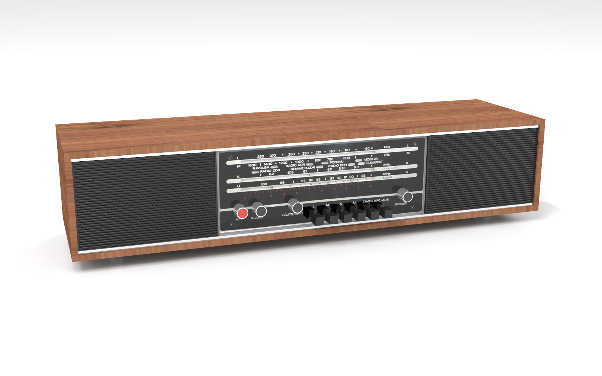

# 3D-Druckteile für das Technikfach

Die Renderings entstehen aus `render/render.py` (POV-Ray) mit dem Dekor Nuss Sizilia und dem entzerrten Foto der Frontplatte. Nachts leuchtet die Skala von hinten, die rote Spalte ist ein LED-Senderzeiger.

| Datei | Inhalt |
|---|---|
| `traeger.scad` | alle Druckteile, Maße oben als Parameter |
| `stl/*.stl` | fertige Druckdateien, schon richtig gedreht |
| `render/render.py` | erzeugt die Renderings neu (`python3 render.py 1600 1000 gut`) |

## Teile

Ausgelegt für den **Qidi Plus 4** (Bauraum 305 × 305 × 280 mm, Düse 0,4 mm) und **OrcaSlicer**. Die STL-Dateien sind schon richtig gedreht und liegen auf z = 0; in Orca nur importieren, „Anordnen“ drücken und slicen.

| Teil | Datei | Größe (mm) | Material | Anzahl |
|---|---|---|---|---|
| Träger, einteilig (A/E, Klang, Lautstärke, 6 Tasten, Sender) | `traeger.stl` | 296 × 53 × 34 | PETG schwarz | 1 |
| *oder* Träger links / rechts (für Drucker unter 300 mm) | `traeger_links.stl`, `traeger_rechts.stl` | 122 × 53 × 34, 180 × 53 × 34 | PETG schwarz | je 1 |
| Lichtkasten hinter der Skala (optional) | `lichtkasten.stl` | 200 × 56 × 28 | PETG oder PLA weiß | 1 |
| Halter für Pi mit DigiAMP+ | `pi_halter.stl` | 97 × 68 × 11,5 | PETG | 1 |
| Hülsen Pi–DigiAMP+ (nur falls keine Bolzen beiliegen) | `pi_huelsen.stl` | Ø 6 × 11,5 | PETG | 4 (in einer Datei) |
| Halter für die Steuerplatine | `steuer_halter.stl` | 82 × 62 × 10,5 | PETG | 1 |
| Halteplatte Original-A/E-Schalter | `ae_platte.stl` | 28 × 31 × 3 | PETG | 1 |
| Kupplung Drehgeber → 3-mm-Stift | `kupplung.stl` | Ø 11 × 22 | PETG | 3 (in einer Datei) |
| Tastenadapter Cherry MX → Taste | `tastenadapter.stl` | 11 × 11 × 8 | PETG | 6 (in einer Datei) |

Der einteilige Träger braucht keine Verbindungslasche und sitzt gerader. Er ist 296 mm lang: in Orca gerade (an der x-Achse) platzieren, Skirt aus, passt er wegen des Rands nicht, um 45° drehen. Die Träger in Schwarz drucken, damit durch die Tasten- und Knopflöcher nichts Helles durchscheint.

### OrcaSlicer-Einstellungen (Qidi Plus 4)

Drucker „Qidi Plus4 0.4 nozzle“, Filament-Profil des Herstellers (PETG: Kammerheizung aus, Tür zu reicht; PLA wird im Radio über dem Pi zu weich, nur für den Lichtkasten). ASA/ABS geht auch, dann Kammer 60 °C.

| Einstellung | Wert | Warum |
|---|---|---|
| Schichthöhe | 0,2 mm (Tastenadapter 0,12 mm) | Kreuz der Tastenadapter sauber |
| Wände | 4 | Schrauben 2,5 mm und M2,5 schneiden ins Volle |
| Decken/Böden | 5 / 4 Schichten | |
| Füllung | 25 % Gyroid; Kupplung und Tastenadapter 100 % | |
| Elefantenfuß-Kompensation | 0,15 mm | Lager- und Schraublöcher, die auf dem Bett liegen, bleiben rund |
| X-Y-Lochkompensation | 0,1 mm | Ø 3 für den Stift, Ø 3,4 Lager, D-Bohrung |
| Nahtposition | ausgerichtet, hinten | |
| Stützen | nur Träger: „Baum (automatisch)“, nur auf dem Druckbett, Überhangwinkel 50° | einziger Überhang sind die beiden Schraubflansche |
| Brim | Träger und Lichtkasten: 5 mm außen | lange, dünne Teile, gegen Ablösen an den Ecken |

**Druckhinweise:**
- **Träger:** liegt mit der Vorderseite auf dem Bett; Rohre, Säulen und Lagerbohrungen stehen senkrecht und werden rund. Stützmaterial nur unter den Schraubflanschen außen.
- **Lichtkasten:** liegt mit dem Diffusor (0,8 mm, also 4 Schichten à 0,2 mm) auf dem Bett. Brücken nur 13 mm lang.
- **Kupplungen:** stehen, D-Bohrung oben. Die Stiftbohrung vorne mit 3,0 mm nachbohren; die D-Bohrung nur nacharbeiten, wenn sie klemmt (Flachseite feilen).
- **A/E-Halteplatte, Pi- und Steuerhalter:** liegen flach, keine Stützen.
- **Tastenadapter:** stehen auf der Platte, der Stößel mit dem Kreuz zeigt nach oben. Sitzt das Kreuz zu stramm, im Modell das Spiel vergrößern.

## Aufbau hinter der Frontplatte

Maße ab der linken unteren Ecke der Frontplatte (px nach rechts, pz nach oben). Die Lage der Löcher stammt aus deinen Messungen.

| Element | px | pz | Bauteil |
|---|---|---|---|
| A/E | 29 | 33 | Original-A/E-Schalter (RFT) auf Halteplatte |
| Klang | 54 | 33 | Drehgeber STEC12E07 mit Kupplung |
| Lautstärke | 104 | 33 | Drehgeber STEC12E07 mit Kupplung |
| Sender | 264 | 33 | Drehgeber STEC12E07 mit Kupplung |
| 6 Tasten | 132,5 bis 232,5 (Raster 20) | 13,5 | Cherry MX Blue mit Adapter und Originaltaste |

- **Frontplatte:** wird durch ihre 4 Eckbohrungen (19 mm vom Rand) mit den Originalschrauben und -muttern durch die Frontbretter geschraubt (Mutter hinten). Die Flansche der Träger haben hinter den unteren Bohrungen eine Aussparung 10 × 10 mm für Mutter und Schraubenende (Parameter `fp_schraube`, `fp_mutter_d`); ihre eigenen Befestigungsschrauben sitzen deshalb höher.
- **Träger:** sitzt direkt hinter der Frontplatte (0,3 mm Luft). Je ein Flansch links und rechts wird mit 2 Spax 2,5 × 8 hinten an das Frontbrett geschraubt. Nur bei der zweiteiligen Version verbindet in der Mitte eine Lasche beide Teile (Schraube 2,5 × 8 von hinten).
- **Originalknöpfe:** Bohrung Ø 3 mm, 17 mm tief (gemessen). Die Knopfrückseite steht 0,5 mm vor der Frontplatte; die Achse steckt 16 mm im Knopf (1 mm Reserve).
- **Drehgeber mit Kupplung:**
  - Die Drehgeberwelle (Ø 6 mm, abgeflacht) passt nicht in den Knopf. Deshalb sitzt auf ihr eine gedruckte Kupplung (Ø 11 × 22 mm) mit einem Stahlstift Ø 3 × 30 mm (Zylinderstift ISO 2338) vorne.
  - Zusammenbau: Stift 7 mm tief in die Kupplung kleben (2K-Epoxid). Hinten hat die Kupplung eine D-Bohrung (10 mm tief), die auf den abgeflachten Teil der Welle passt (laut Datenblatt 7 mm lang, Ø 6 auf 4,5 abgeflacht) und die Drehung formschlüssig überträgt. Die Kupplung steckt 6,5 mm auf der Welle und nicht auf dem runden Teil davor. Nicht auf die Welle kleben: Sie wird nur aufgesteckt. Klemmt die D-Bohrung, mit 6-mm-Bohrer vorsichtig nacharbeiten bzw. die Flachseite feilen.
  - Der Turm im Träger ist ein Rohr (Ø 11,8 mm), in dem sich die Kupplung frei dreht. Der Stift läuft vorne in einer Lagerbohrung Ø 3,4 mm in der Trägerwand (mit 3,2 mm nachbohren, wenn er wackelt) und ragt durch das Loch der Frontplatte 16 mm in den Knopf.
  - Jeder Drehgeber wird auf ein Stück Lochraster 20 × 25 mm gelötet, mit den zwei Pull-up-Widerständen (10 kΩ an A und B). Für die zwei Snap-In-Laschen die Löcher im Lochraster auf Ø 2 mm aufbohren. Die Platine wird mit 2 Schrauben 2,5 × 8 an die Säulen des Turms geschraubt (Säulen 21 mm auseinander) und drückt den Drehgeber gegen das Rohr. Maße laut ALPS-Datenblatt EC12 (Zeichnung 2, „short shaft“): Welle 15 mm ab Platine, davon 5 mm Gehäuse mit Bund Ø 6,6; Bundoberkante bei y = 39,3.
  - Kupplung, Stift und Drehgeber werden zusammen von hinten in das Rohr geschoben.
- **A/E-Schalter (Original, RFT):**
  - Der Schalter wird mit seiner eigenen Mutter und Scheibe auf die Halteplatte (Loch Ø 10,5 mm, passt für Gewinde M8 bis M10) geschraubt; der Flansch liegt hinten an der Platte.
  - Die Platte wird mit 2 Schrauben 2,5 × 8 an zwei Säulen des Trägers geschraubt (Säulen 6,2 mm lang, Bohrung 8,6 mm tief). Gewindebuchse und Welle gehen durch ein Loch Ø 11 mm in der Trägerwand und durch die Frontplatte in den Originalknopf.
  - Maße (gemessen): Flansch bis Wellenende 32 mm, dünnes Wellenende 18 mm, der Knopf steckt 16 mm darauf. Damit liegt der Flansch 22,5 mm hinter der Frontplatten-Vorderseite, die Platte davor bei 19,5–22,5 mm. Länge der Gewindebuchse (8 mm), Gehäuse-Ø (25) und -tiefe (13) sind weiter aus dem Foto geschätzt; die Buchse darf bis 12 mm lang sein (ab 9 mm ragt sie in das Loch Ø 11 der Trägerwand).
  - Der Schalter führt nur noch 0,4 mA Steuerstrom; die 19 V schaltet das Pololu-Modul auf der Steuerplatine (README, „Stromversorgung und A/E-Schalter“).
- **Tasten:**
  - Die Cherry-MX-Schalter rasten in eine 1,5 mm dicke Schalterplatte mit 14 × 14 mm Ausschnitten. Die Platte liegt 22,6 mm hinter der Rückseite der Frontplatte.
  - Auf jeden Schalter kommt ein Tastenadapter. Die Originaltaste wird mit Zweikomponentenkleber auf dessen 11 × 11 mm Platte geklebt: Kleber auf die Stirnflächen des inneren Rahmens und der Rippen in der Taste, Adapter mittig aufsetzen, Taste gerade ausrichten (am besten im eingebauten Schalter mit eingesetzter Frontplatte aushärten lassen, dann sitzt sie mittig im Fenster).
  - Die Taste ragt dann 8 mm vor die Frontplatte und gedrückt noch 4 mm.
  - Der Adapter taucht beim Drücken in den Schalter ein, ohne anzustoßen.
- **Lichtkasten (nur mit Beleuchtung, optional):**
  - Er sitzt über den Trägern direkt hinter der Skala, liegt auf zwei Auflagen und wird mit 2 Schrauben 2,5 × 10 festgeschraubt.
  - Innen hat er 4 Kammern: U-Band, K-Band, Stationsmarken und L-Band. Trennwände verhindern, dass Licht zwischen den Reihen überspricht.
  - Die LED-Streifen kleben innen auf der Rückwand. Das Kabel geht durch den Schlitz rechts hinten.
  - Strom und Ansteuerung: README, „LED-Skala (optional)“. 5 V aus dem eigenen Wandler (Pololu D24V10F5) auf der Steuerplatine, Daten von GPIO12 über den 74HCT245.
- **Pi-Halter:**
  - Er liegt auf dem Boden des Technikfachs, wird mit 4 Spax 3 × 10 festgeschraubt und hält den Pi.
  - Vier gedruckte Säulen (9 mm hoch, Ø 6, Bohrung Ø 2,2 × 10 mm); keine gekauften Abstandshalter nötig. Pi auflegen, die Abstandsbolzen des DigiAMP+ (Lieferumfang, Außengewinde nach unten) durch die Pi-Löcher in die Säulen drehen; das M2,5-Gewinde schneidet sich in den Kunststoff. Nicht zu fest anziehen. DigiAMP+ aufstecken und oben mit den mitgelieferten Schrauben verschrauben. Erst danach den Halter in den Boden schrauben.
  - Liegen beim DigiAMP+ keine Bolzen bei: 4 Hülsen drucken (`teil = "pi_huelsen"`, Ø 6 × 11,5 mm) und mit 4 Schrauben M2,5 × 25 von oben durch DigiAMP+, Hülse und Pi in die Säulen schrauben.
  - Der Pi liegt mit der GPIO-Kante nach vorne, 65 mm hinter der Frontplatte (hinter den Drehgebern). Hohlbuchse und Lautsprecherklemmen des DigiAMP+ liegen an der gegenüberliegenden Kante und zeigen zur Rückwand, gut erreichbar über den magnetischen Deckel. USB und Ethernet des Pi zeigen nach links.
- **Steuerplatinen-Halter:**
  - Rechts neben dem Pi, ebenfalls mit 4 Spax 3 × 10 am Boden. Trägt die Lochrasterplatine 70 × 50 mm auf vier 8 mm hohen Säulen.
  - Löcher in die Lochrasterplatine bohren (Ø 2,2 mm, Abstand 66 × 46 mm, mittig), mit 4 Schrauben 2,2 × 6,5 festschrauben. Bei anderen Lochabständen `st_loch` in `traeger.scad` ändern.
  - Liegt nahe an der Netzbuchse im Rückwanddeckel; kurze, dicke Leitungen.

## Beleuchtung hinter der Frontplatte

### Was ist durchsichtig?

Aus dem Foto ausgewertet: Die Frontplatte ist durchsichtiger Kunststoff, hinten schwarz und silbern bedruckt. Licht kommt nur an diesen Stellen durch:

| Stelle | Lage (pz) | Größe |
|---|---|---|
| Skalenschlitz L | 94 bis 99,5 | 190 × ca. 5 mm |
| 10 Stationsmarken (zwei Reihen) | 79,5 bis 89 | je ca. 10 × 3 mm |
| Skalenschlitz K (49-m-Band) | 69 bis 74,5 | 190 × ca. 5 mm |
| Skalenschlitz U | 56,5 bis 61,5 | 190 × ca. 5 mm |
| klarer Rand rundum | – | ca. 3 mm |

Die Ziffern und Striche selbst sind gedruckt und lassen kein Licht durch.

### Display: nicht sinnvoll

Ein Bildschirm hinter der Platte wäre nur durch die drei 5 mm hohen Schlitze zu sehen. Ein passendes Display mit 190 mm Breite und 45 mm Höhe gibt es nur als teures Spezialteil. Mehr als leuchtende Streifen würde man trotzdem nicht sehen. Das Gleiche erreicht ein LED-Streifen viel einfacher.

### LED-Lichtkasten: sinnvoll, im Modell schon vorgesehen

Hinter jedem Schlitz liegt eine eigene Kammer mit einem LED-Streifen. Der weiße 0,8-mm-Diffusor vorne verteilt das Licht gleichmäßig, wie die alten Skalenlampen.

- **Streifen:** WS2812B mit 144 LEDs/m und 10 mm Breite. Etwa 4 × 28 LEDs (4 × 194 mm), zusammen 112 LEDs. Einzeln ansteuerbare LEDs können einen **Senderzeiger** darstellen. An der Position des eingestellten Senders leuchtet in allen Reihen eine LED rot, wie der Zeiger früher. Für das aktive Band leuchtet die passende Reihe heller.
- **Ansteuerung:** direkt vom Pi über PWM an GPIO12 (GPIO12 ist der einzige freie PWM-Pin), Pegelwandler 74HCT245 auf der Steuerplatine. Der früher vorgesehene RP2040-Zero am USB entfällt.
- **Strom:** Bei voller Helligkeit in Weiß bräuchten 112 LEDs fast 7 A. Sie hängen deshalb an einem eigenen 5-V-Wandler (Pololu D24V10F5, 1 A) aus den 19 V, nicht am Pi. In der Software auf höchstens 0,8 A begrenzen (Weiß bis 10 %, Warmweiß bis etwa 15 %).
- **Entscheidung (18.11.2026):** WS2812B mit Senderzeiger, als Option. Ohne Beleuchtung entfallen Lichtkasten, Streifen und der LED-Teil der Steuerplatine.
- **Tasten beleuchten (optional):** Cherry-MX-Schalter haben eine Öffnung für eine 3-mm-LED. Mit durchscheinenden Tastenkappen könnte die gedrückte Bandtaste leuchten. Die Originaltasten sind aber schwarz und undurchsichtig.

## Noch offen

- **Lochabstand der Lochrasterplatine** für den Steuerplatinen-Halter (angenommen 66 × 46 mm, selbst gebohrt).
