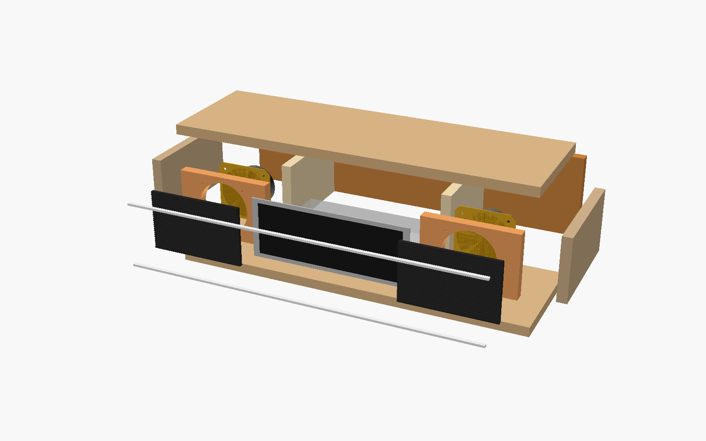

# Gehäuse

Neues Gehäuse aus 19-mm-Spanplatte (Dekor). Vom Originalradio bleiben die Frontplatte (300 × 114 × 3 mm) und die beiden geriffelten Lautsprecherabdeckungen (178 × 112 × 7 mm). Abdeckung, Frontplatte und Abdeckung sitzen stumpf nebeneinander. Links und rechts ist je eine geschlossene Lautsprecherkammer, in der Mitte hinter der Frontplatte das Technikfach.

**Außenmaß: 694 × 160 × 240 mm** (Breite × Höhe × Tiefe inkl. Rückwand)

| Datei | Inhalt |
|---|---|
| `gehaeuse.scad` | 3D-Modell, alle Maße oben als Parameter (OpenSCAD) |
| `zeichnung_gehaeuse.pdf` | Maßzeichnungen, 2 Blätter |
| `zeichnung.py` | erzeugt die Zeichnungen neu, falls sich Maße ändern |
| `bilder/` | Ansichten und Zeichnungen als PNG |

## Aufbau

- **Front:** Abdeckungen und Frontplatte liegen bündig in einer Ebene, 10 mm hinter der Holzvorderkante. Innenmaß der Öffnung 656 × 122 mm.
- **Chromleisten:** oben und unten je eine 4 mm hohe Leiste über die ganze Breite (656 mm), wie beim Original. Sie füllt den 4-mm-Spalt zwischen Holz und Frontplatte. Aufbau: Trägerleiste 4 × 7 mm, an der Vorderseite mit selbstklebender Chromzierleiste 4 mm beklebt. Die Abdeckungen sind 112 mm hoch und die Frontplatte 114 mm, deshalb bleibt über und unter den Abdeckungen je 1 mm Luft.
- **Lautsprecherkammern:** geschlossen, innen 159 × 122 × 185 mm, also 3,6 l brutto und etwa 3,3 l nach Abzug des Lautsprechers. Die Schallwand (19 mm) sitzt direkt hinter der Abdeckung, der Lautsprecher mittig dahinter, von hinten angeschraubt.
- **Technikfach:** 300 × 122 mm innen, etwa 200 mm tief. Hier kommt im nächsten Schritt der 3D-gedruckte Träger mit Pi, Verstärkerplatine, Tasten und Drehgebern hinein. Er hält auch die Frontplatte.
- **Rückwand:** abnehmbar, auf die Kanten geschraubt. Lüftungslöcher gibt es nur über dem Technikfach, damit die Lautsprecherkammern dicht bleiben.

## Warum 240 mm tief

Der Lautsprecher arbeitet in einer geschlossenen Kammer. Je größer die Kammer, desto tiefer reicht der Bass, bis das Volumen etwa dem Luftfeder-Volumen des Lautsprechers (Vas) entspricht. Darüber bringt mehr Volumen kaum noch etwas. Für das Sharp-Chassis gibt es keine Datenblattwerte. Für 10-cm-Breitbänder liegen 3 bis 4 l geschlossen im üblichen Bereich.

| Außentiefe | Kammer netto |
|---|---|
| 180 mm | 2,1 l |
| 220 mm | 2,9 l |
| **240 mm** | **3,3 l** |
| 260 mm | 3,7 l |
| 300 mm | 4,5 l |

Mit 240 mm liegt die Kammer in diesem Bereich, und das Radio bleibt ein flacher Kasten. Für die Klangqualität zählen außerdem:

- **Dämmwolle:** Jede Kammer locker zu etwa zwei Dritteln mit Polyesterwatte füllen (z. B. Sonofil oder Kissenfüllung), auch direkt hinter dem Magnet. Das dämpft Resonanzen und wirkt akustisch wie 10 bis 20 % mehr Volumen.
- **Dicht:** Alle Fugen der Kammer verleimen bzw. mit Acryl abdichten, Kabeldurchführung mit Heißkleber verschließen, Dichtband unter der Rückwand. Ein Leck klingt wie ein schlecht abgestimmtes Bassreflexrohr.
- **Getrennte Kammern:** Jeder Lautsprecher hat seine eigene Kammer, das Technikfach ist offen und belüftet.

Wenn es genauer gehen soll: Mit einem Messmikrofon oder einer USB-Soundkarte, einem Widerstand und dem kostenlosen Programm REW lassen sich fs, Qts und Vas messen. Dann kann man die Tiefe exakt berechnen und prüfen, ob sich ein Bassreflexrohr lohnt.

## Zuschnittliste (19 mm Spanplatte)

| Teil | Anzahl | Maß (mm) | Kanten mit Umleimer |
|---|---|---|---|
| Deckel | 1 | 694 × 221 | vorne, links, rechts |
| Boden | 1 | 694 × 221 | vorne, links, rechts |
| Seitenwand | 2 | 221 × 122 | vorne |
| Zwischenwand | 2 | 185 × 122 | – |
| Schallwand | 2 | 178 × 122 | – |
| Rückwand | 1 | 694 × 160 | rundum |

Bei Deckel, Boden und Rückwand ist die erste Zahl die Breite, bei Seiten- und Zwischenwand die Tiefe. Die Fläche beträgt zusammen etwa 0,56 m². Den Zuschnitt kann der Baumarkt machen. Dazu braucht es etwa 4,5 m Kantenumleimer im passenden Dekor zum Aufbügeln.

## Lautsprecher Sharp VSP0010PBS78A

10 cm, 8 Ω, max. 20 W. Korb 110 × 110 mm, vier Schraublöcher Ø 5 mm im Quadrat mit 84 mm Abstand, Innendurchmesser Blechring 100 mm, Bautiefe etwa 47 mm (aus Foto).

- **Ausschnitt in der Schallwand: Ø 100 mm**, genau mittig (89 mm von links, 61 mm von unten). Mit einer Lochsäge 100 mm, einem Kreisschneider oder Stichsäge. 102 mm geht auch noch: Der Korb liegt dann an den geraden Seiten nur noch 4 mm auf, der Schaumstoffring dichtet trotzdem.
- **Schrauben:** vier Spax 4 × 20 mit Unterlegscheibe, vorbohren Ø 2,5 mm. Lochbild am besten mit dem Lautsprecher anzeichnen.
- Der Lautsprecher wird von hinten an die Schallwand geschraubt, der Flansch mit dem Schaumstoffring liegt an der Schallwand.

## Zusammenbau

1. Alle Sichtkanten mit Umleimer bekleben, Reste abschneiden und schleifen.
2. Schallwände bohren (Ausschnitt und Schraublöcher).
3. Korpus: Deckel, Boden und Seitenwände mit Holzdübeln 8 × 35 und Holzleim verbinden, je Ecke 3 Dübel. Die Seitenwände stehen zwischen Deckel und Boden. Diagonalen messen, damit der Kasten rechtwinklig wird.
4. Schallwände 17 mm hinter der Holzvorderkante einleimen (10 mm Rücksprung + 7 mm Abdeckung), außen an die Seitenwände. Ein 17 mm breites Holzstück als Abstandslehre hilft.
5. Zwischenwände direkt hinter den Schallwänden einleimen, 159 mm von der Seitenwand-Innenseite. Von unten durch den Boden je 2 Schrauben 4 × 40.
6. Fugen in den Kammern innen abdichten. In jede Zwischenwand ein Loch Ø 6 mm für das Lautsprecherkabel, nach dem Durchführen mit Heißkleber verschließen.
7. Lautsprecher anschrauben, Kammern mit Dämmwolle füllen.
8. Chromleisten: Trägerleisten 4 × 7 × 656 mm oben und unten in den Rücksprung kleben, Vorderseite bündig mit der Vorderseite der Abdeckungen. Dann die Chromzierleiste vorne aufkleben.
9. Abdeckungen mit doppelseitigem Montageband (Spiegelklebeband) auf die Schallwände kleben.
10. Rückwand: Lüftungslöcher und Loch für die Netzteilbuchse bohren. Dichtband auf die Kanten der Kammern kleben. Rückwand mit Spax 4 × 40 in die Kanten von Deckel, Boden, Seiten- und Zwischenwänden schrauben, vorbohren Ø 2,5 mm.
11. Vier Filz- oder Gummifüße unter den Boden.

## Einkaufsliste

- Spanplatte 19 mm Dekor, Zuschnitt nach Liste
- Kantenumleimer im gleichen Dekor, ca. 4,5 m
- Chromzierleiste selbstklebend, 4 mm breit, ca. 1,5 m
- Material für die Trägerleisten 4 × 7 mm, 2 × 656 mm (siehe offene Frage)
- Holzdübel 8 × 35, Holzleim, Dübelbohrer 8 mm, Dübelmarkierer oder Dübellehre
- Spax 4 × 40 (ca. 25 Stück), Spax 4 × 20 (8 Stück) mit Unterlegscheiben
- Lochsäge Ø 100 mm (oder Kreisschneider)
- Dichtband 9 × 3 mm, ca. 2 m
- Polyesterwatte zum Dämmen, ca. 100 g
- doppelseitiges Montageband, Möbelfüße

Bilder neu erzeugen: `openscad -o bilder/ansicht_vorne.png gehaeuse.scad` und `python3 zeichnung.py`.
