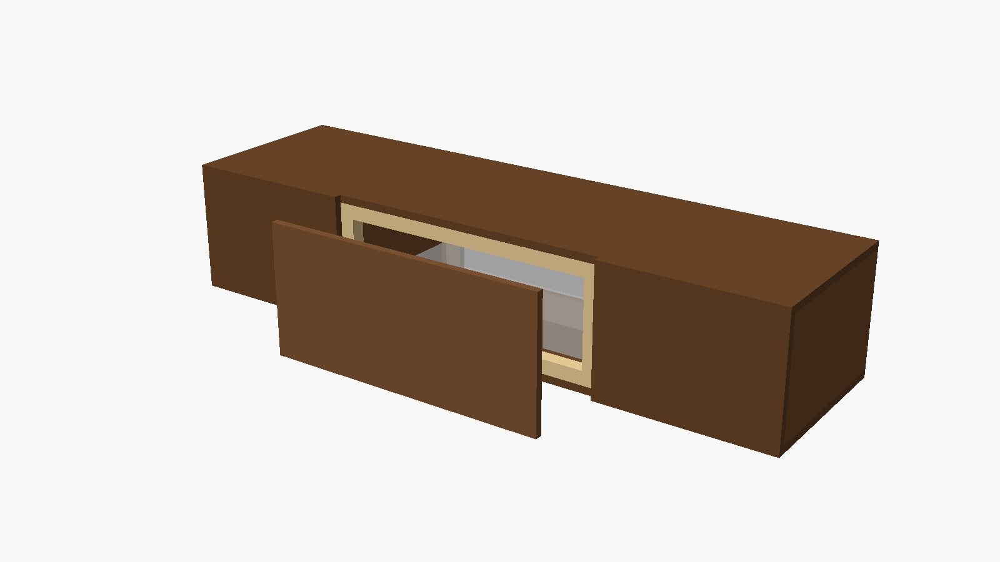

# Gehäuse

Gehäuse aus 8-mm-Spanplatte Dekor Nussbaum. Vom Originalradio bleiben die Frontplatte (300 × 114 × 3 mm) und die beiden geriffelten Lautsprecherabdeckungen (178 × 112 × 7 mm). Abdeckung, Frontplatte und Abdeckung sitzen stumpf nebeneinander, die Abdeckungen stoßen links und rechts an die Seitenwände. Links und rechts ist je eine geschlossene Lautsprecherkammer mit 3 l, in der Mitte das Technikfach.

**Außenmaß: 672 × 138 × 190 mm** (Breite × Höhe × Tiefe inkl. Rückwand), dazu 20 mm Füße.

| Datei | Inhalt |
|---|---|
| `gehaeuse.scad` | 3D-Modell, alle Maße oben als Parameter (OpenSCAD) |
| `zeichnung_gehaeuse.pdf` | Maßzeichnungen, 2 Blätter |
| `zeichnung.py` | erzeugt die Zeichnungen neu, falls sich Maße ändern |
| `bilder/` | Ansichten und Zeichnungen als PNG |

## Aufbau

- **Front:** Das Holz steht 3 mm vor den Abdeckungen. Die Frontplatte ist hinten bündig mit den Abdeckungen und liegt deshalb 4 mm tiefer.
- **Chromleisten:** oben und unten je eine Alu-Vierkantstange 4 × 4 mm, 656 mm lang, vorne bündig mit den Abdeckungen. Sie wird innen an Deckel bzw. Boden geklebt. Für Chromglanz die Sichtseite vorher schleifen (Körnung 400 bis 2000, nass) und mit Polierpaste polieren.
- **Frontbretter:** zwei Bretter 203 × 122 mm, je eins hinter einer Abdeckung. Jedes ragt 25 mm hinter die Frontplatte, dort liegt die Frontplatte auf. Dazwischen bleiben 250 mm frei für Tasten, Drehgeber und den 3D-gedruckten Träger.
- **Lautsprecherkammern:** innen 170 × 122 × 164 mm, 3,4 l brutto, **3,0 l netto** nach Abzug von Leisten und Lautsprecher. Der Lautsprecher sitzt mittig hinter der Abdeckung.
- **Technikfach:** 300 × 122 mm innen, 164 mm tief.
- **Rückwand dreiteilig:** Hinter den Kammern je ein fest verleimtes Teil (186 × 138 mm), das die Kammer luftdicht schließt. In der Mitte ein abnehmbarer Deckel (300 × 138 mm) mit Lüftungslöchern und Netzteilbuchse, mit 4 Schrauben an Kiefernleisten befestigt.
- **Abdeckungen abnehmbar:** je vier Neodym-Magnete 10 × 3 mm bündig in Bohrungen Ø 12 × 4 mm im Frontbrett, auf der Rückseite der Abdeckung je ein Stahlplättchen Ø 10 × 1 mm. Die Plättchen tauchen in die Bohrungen ein, so liegt die Abdeckung flach auf. Magnetmitten 15 mm von der Außenkante der Abdeckung und 15 mm von der Ober- bzw. Unterkante des Frontbretts. Zum Abnehmen mit dem Fingernagel an der Kante zur Frontplatte ansetzen; dort steht die Abdeckung 4 mm vor.
- **Verbindungen:** In 8 mm Spanplatte halten weder Dübel noch Schrauben in der Kante. Alle Ecken sind deshalb innen mit Kiefern-Vierkantleisten 15 × 15 mm verleimt.
- **Füße:** 4 Chromfüße Ø 25 mm, 20 mm hoch, 60 mm von der Seite und 55 mm von vorne bzw. hinten, innen je ein Klötzchen für die Schraube.

## Lautsprecher fest eingebaut

Weil die Rückwand hinter den Kammern verleimt ist, kommt man an die Lautsprecher später nur noch von vorne heran. Der Korb (110 mm) passt nicht durch das Loch (100 mm), ein Tausch ist dann nicht mehr möglich. Deshalb vor dem Verleimen:

- Kabel anlöten, durch die Zwischenwand ins Technikfach führen und das Loch mit Heißkleber dicht machen.
- Die M4-Muttern hinten mit Schraubensicherung oder Zweikomponentenkleber am Korb fixieren. Dann lassen sich die Schrauben von vorne lösen, ohne dass die Mutter mitdreht.
- Dämmwolle einlegen.

Soll der Lautsprecher tauschbar bleiben, können die beiden äußeren Rückwandteile statt verleimt mit Dichtband verschraubt werden. Dafür ist die gleiche Leistenanordnung schon da.

## Zuschnittliste (8 mm Spanplatte Dekor Nussbaum)

| Teil | Anzahl | Maß (mm) | Kanten mit Umleimer |
|---|---|---|---|
| Deckel | 1 | 672 × 182 | vorne, links, rechts |
| Boden | 1 | 672 × 182 | vorne, links, rechts |
| Seitenwand | 2 | 182 × 122 | vorne |
| Frontbrett | 2 | 203 × 122 | – (verdeckt) |
| Zwischenwand | 2 | 164 × 122 | – |
| Rückwand außen | 2 | 186 × 138 | oben, unten, außen |
| Rückwand Mitte | 1 | 300 × 138 | oben, unten |

Bei Deckel, Boden, Frontbrett und Rückwand ist die erste Zahl die Breite, bei Seiten- und Zwischenwand die Tiefe. Die Fläche beträgt zusammen etwa 0,47 m². Kantenumleimer Nussbaum braucht es etwa 4,5 m.

**Kiefer-Vierkantleiste 15 × 15 mm**, zusammen etwa 3 m (3,5 m kaufen):

| Lage | Anzahl | Länge (mm) |
|---|---|---|
| längs in den Ecken Seite/Deckel und Seite/Boden | 4 | 164 |
| längs an den Zwischenwänden oben und unten (Kammerseite) | 4 | 149 |
| hinten senkrecht an Seitenwänden und beidseits der Zwischenwände | 6 | 92 |
| hinten waagerecht im Technikfach | 2 | 300 |
| hinten waagerecht in den Kammern | 4 | 140 |
| Klötzchen unter den Füßen (ca. 30 × 30 × 10, Reststücke) | 4 | – |

## Lautsprecher Sharp VSP0010PBS78A

10 cm, 8 Ω, max. 20 W. Korb 110 × 110 mm, vier Löcher Ø 5 mm im Quadrat mit 84 mm Abstand, Blechring innen 100 mm, Bautiefe etwa 47 mm.

- **Ausschnitt im Frontbrett: Ø 100 mm**, 89 mm von der Außenkante des Frontbretts und mittig in der Höhe (61 mm). Mit Lochsäge 100 mm, Kreisschneider oder Stichsäge.
- **Befestigung:** vier Löcher Ø 4,5 mm im Quadrat 84 mm, vorne angesenkt. M4 × 20 Senkkopf von vorne, hinten Scheibe und Mutter. Die Köpfe liegen bündig, damit die Abdeckung flach aufliegt.
- **Dämmung:** Jede Kammer locker zu etwa zwei Dritteln mit Polyesterwatte füllen.

## Zusammenbau

1. Sichtkanten mit Umleimer bekleben, bündig abschneiden und schleifen.
2. Frontbretter: Lautsprecherloch, Schraublöcher (angesenkt) und die 4 Magnetbohrungen Ø 12 × 4 mm bohren (Forstnerbohrer mit Tiefenanschlag, nicht durchbohren).
3. Leisten zuschneiden.
4. Kasten: Seitenwände zwischen Deckel und Boden stellen und die Eckleisten längs innen einleimen. Die Leisten beginnen 18 mm hinter der Vorderkante (3 mm Überstand + 7 mm Abdeckung + 8 mm Frontbrett) und enden hinten bündig. Mit Zwingen pressen und die Diagonalen prüfen.
5. Frontbretter 10 mm hinter der Vorderkante einleimen, außen an die Seitenwände. Sie liegen hinten an den Stirnseiten der Leisten an. Ein 10 mm breites Holzstück als Abstandslehre hilft.
6. Zwischenwände einleimen: 170 mm von der Seitenwand-Innenseite, vorne stumpf an das Frontbrett, mit den Längsleisten an Deckel und Boden.
7. Hintere Leisten einleimen, hinten bündig mit den Kanten.
8. Klötzchen für die Füße innen auf den Boden leimen.
9. Fugen in den Kammern mit Acryl abdichten. In jede Zwischenwand ein Loch Ø 6 mm für das Lautsprecherkabel bohren.
10. Lautsprecher anschrauben (siehe „Lautsprecher fest eingebaut“), Kabel durchführen und abdichten, Dämmwolle einlegen.
11. Äußere Rückwandteile auf Kanten und Leisten der Kammern leimen.
12. Alu-Vierkantstangen auf 656 mm ablängen, Sichtseite polieren und mit Zweikomponentenkleber oder Montagekleber oben und unten einkleben, Vorderseite 3 mm hinter der Holzkante.
13. Magnete in die Bohrungen kleben. Stahlplättchen auf die Magnete legen, Kleber auf die Plättchen geben und die Abdeckung genau positioniert aufdrücken. So sitzen die Plättchen automatisch an der richtigen Stelle. Nach dem Aushärten abnehmen.
14. Füße mit Spax 3,5 × 16 durch den Boden in die Klötzchen schrauben.
15. Mittleres Rückwandteil: Lüftungslöcher und Loch für die Netzteilbuchse bohren, mit 4 Spax 3,5 × 20 an die Leisten des Technikfachs schrauben.

## Einkaufsliste

- Spanplatte 8 mm Dekor Nussbaum, Zuschnitt nach Liste
- Kantenumleimer Nussbaum, ca. 4,5 m
- Kiefer-Vierkantleiste 15 × 15 mm, ca. 3,5 m
- Alu-Vierkantstange 4 × 4 mm, 2 × 0,75 m (Evek, Amazon), Nassschleifpapier 400–2000, Polierpaste
- 4 Möbelfüße Chrom, ca. Ø 25 mm, 20 mm hoch, zum Anschrauben
- 8 × M4 × 20 Senkkopf mit Muttern und Scheiben, Schraubensicherung
- 8 Neodym-Scheibenmagnete 10 × 3 mm, 8 Stahlplättchen Ø 10 × 1 mm
- Spax 3,5 × 20 (4 Stück), Spax 3,5 × 16 (4 Stück)
- Holzleim, Zweikomponentenkleber, Acryl, Heißkleber
- Lochsäge Ø 100 mm, Forstnerbohrer 12 mm, Kegelsenker, Zwingen
- Polyesterwatte, ca. 100 g

## Ist 8 mm zu dünn?

Es geht, liegt aber an der unteren Grenze. Mit den verleimten Leisten wird der Kasten steif genug. Die Kammerwände sind klein und rundum verleimt, mit Dämmwolle schwingen sie kaum hörbar mit. 8 mm Spanplatte Dekor in Nussbaum gibt es eher beim Online-Plattenzuschnitt als im Baumarkt. 10 oder 12 mm wären robuster; dafür in `gehaeuse.scad` und `zeichnung.py` nur `t` ändern.

Bilder neu erzeugen: `openscad -o bilder/ansicht_vorne.png gehaeuse.scad` und `python3 zeichnung.py`.
