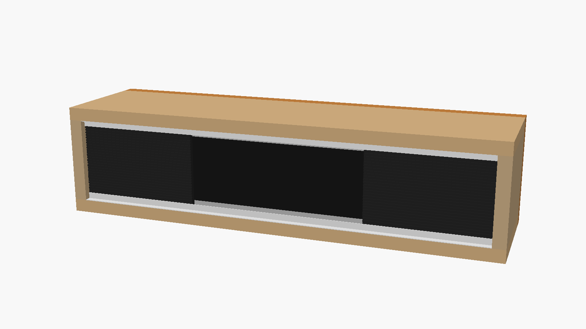
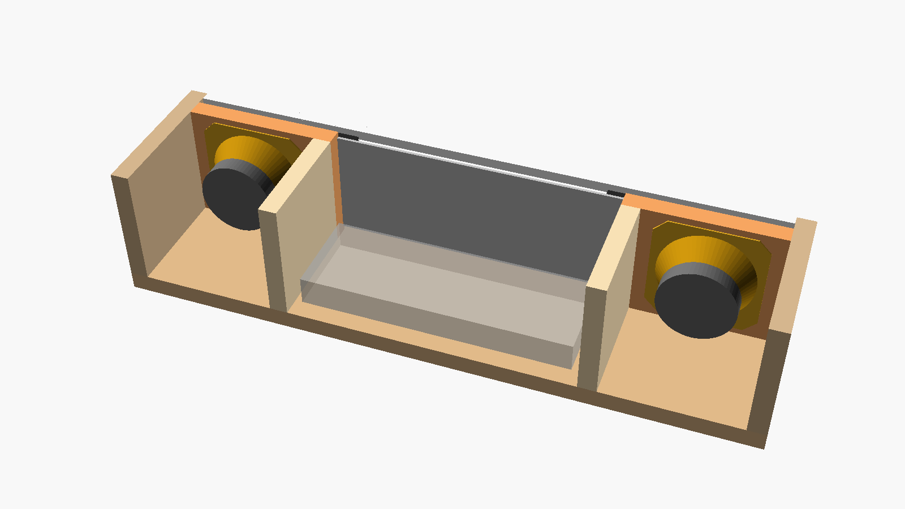

# Gehäuse

Neues Gehäuse aus 19-mm-Spanplatte (Dekor). Vom Originalradio bleiben die Frontplatte (300 × 114 × 3 mm) und die beiden geriffelten Lautsprecherabdeckungen (178 × 112 mm). Links und rechts sitzt je ein Lautsprecher in einer geschlossenen Kammer, in der Mitte hinter der Frontplatte das Technikfach.

**Außenmaß: 656 × 164 × 180 mm** (Breite × Höhe × Tiefe inkl. Rückwand)

| Datei | Inhalt |
|---|---|
| `gehaeuse.scad` | 3D-Modell, alle Maße oben als Parameter (OpenSCAD) |
| `zeichnung_gehaeuse.pdf` | Maßzeichnungen, 2 Blätter |
| `zeichnung.py` | erzeugt die Zeichnungen neu, falls sich Maße ändern |
| `bilder/` | Ansichten und Zeichnungen als PNG |

## Aufbau

- **Front wie beim Original nach innen gesetzt:** Die Abdeckungen sitzen 10 mm hinter der Holzvorderkante. Die Frontplatte liegt 8 mm dahinter und verschwindet links und rechts je 19 mm unter den Abdeckungen. So war es auf deinem Foto zu sehen: Zwischen den Abdeckungen sind nur etwa 262 mm der Frontplatte sichtbar.
- **Chromleisten:** Alu-Winkel 10 × 10 × 1 mm (silber eloxiert oder poliert), oben und unten je 618 mm lang. Ein Schenkel wird innen auf Deckel bzw. Boden geklebt und schließt vorne bündig mit der Holzkante ab, der andere zeigt nach vorn. Der senkrechte Schenkel deckt den 6-mm-Spalt zwischen Holz und Frontplatte ab und hält Abdeckungen und Frontplatte gegen Herausfallen.
- **Lautsprecherkammern:** 140 × 126 × 124 mm innen, je etwa 2,2 l, geschlossen. Die Schallwand (19 mm) sitzt direkt hinter der Abdeckung, der Lautsprecher wird von hinten angeschraubt.
- **Technikfach:** 300 × 126 mm innen, etwa 140 mm tief. Hier kommt im nächsten Schritt der 3D-gedruckte Träger mit Pi, Verstärkerplatine, Tasten und Drehgebern hinein.
- **Rückwand:** abnehmbar, auf die Kanten geschraubt. Nur über dem Technikfach sind Lüftungslöcher, damit die Lautsprecherkammern dicht bleiben.

## Zuschnittliste (19 mm Spanplatte)

| Teil | Anzahl | Maß (mm) | Kanten mit Umleimer |
|---|---|---|---|
| Deckel | 1 | 656 × 161 | vorne, links, rechts |
| Boden | 1 | 656 × 161 | vorne, links, rechts |
| Seitenwand | 2 | 161 × 126 | vorne |
| Zwischenwand | 2 | 124 × 126 | – |
| Schallwand | 2 | 159 × 126 | – |
| Rückwand | 1 | 656 × 164 | rundum |

Die erste Zahl ist bei Deckel, Boden und Rückwand die Breite, bei Seiten- und Zwischenwand die Tiefe. Fläche zusammen etwa 0,46 m². Den Zuschnitt kann der Baumarkt machen. Kantenumleimer etwa 4 m in passendem Dekor (zum Aufbügeln).

## Lautsprecher Sharp VSP0010PBS78A

10 cm, 8 Ω, max. 20 W. Aus deinen Fotos geschätzt:

| Maß | Wert |
|---|---|
| Korb außen | ca. 107–112 mm, fast quadratisch mit abgeschrägten Ecken |
| Sicke außen | ca. 99 mm |
| Bautiefe Flansch bis Magnet | ca. 46–47 mm |
| Magnet | ca. Ø 78 mm |

Ausschnitt in der Schallwand: **Ø 95 mm** (Lochsäge), Mitte 70 mm von der Seitenwand-Innenseite und mittig in der Höhe (63 mm). Der Lochkreis muss kleiner sein als der Korb und darf die Sicke nicht verdecken. Vor dem Sägen den Innendurchmesser des Blechrings messen, an dem die Sicke endet, und das Loch höchstens so groß machen. Die vier Schraublöcher mit dem Lautsprecher als Schablone anzeichnen und mit Holzschrauben 3,5 × 16 befestigen. Der Schaumstoffring am Flansch dichtet ab.

Der Lautsprecher sitzt nicht mittig hinter der Abdeckung, sondern 19 mm nach außen versetzt, weil die Kammer nur 140 mm breit ist. Hinter der Riffelung sieht man das nicht.

## Zusammenbau

1. Alle Sichtkanten mit Umleimer bekleben, überstehende Reste abschneiden und schleifen.
2. Korpus: Deckel, Boden und Seitenwände mit Holzdübeln 8 × 35 und Holzleim verbinden, je Ecke 3 Dübel. Die Seitenwände stehen zwischen Deckel und Boden. Diagonalen messen, damit der Kasten rechtwinklig wird.
3. Schallwände 18 mm hinter der Vorderkante einleimen (10 mm Rücksprung + 8 mm Abdeckung). Zuerst die Stärke deiner Abdeckungen messen und das Maß anpassen.
4. Zwischenwände direkt hinter den Schallwänden einleimen, 140 mm von der Seitenwand-Innenseite. Von unten durch den Boden je 2 Schrauben 4 × 40.
5. Alle Fugen in den Lautsprecherkammern innen mit Leim oder Acryl abdichten. In jede Zwischenwand ein Loch Ø 6 mm für das Lautsprecherkabel bohren, nach dem Durchführen mit Heißkleber verschließen.
6. Lautsprecher von hinten anschrauben.
7. Abdeckungen vorne auf die Schallwände setzen. Befestigung je nach dem, was auf der Rückseite der Abdeckungen ist (siehe offene Fragen).
8. Alu-Winkel auf 618 mm ablängen und mit Montagekleber oder doppelseitigem Klebeband einkleben.
9. Rückwand: Lüftungslöcher und Loch für die Netzteilbuchse bohren, dann mit Schrauben 4 × 40 in die Kanten von Deckel, Boden, Seiten- und Zwischenwänden schrauben (vorbohren Ø 2,5 mm). Auf die Kanten der Lautsprecherkammern vorher Dichtband (z. B. Fensterdichtband 9 × 3 mm) kleben.
10. Vier Filz- oder Gummifüße unter den Boden.

## Einkaufsliste

- Spanplatte 19 mm Dekor, Zuschnitt nach Liste
- Kantenumleimer im gleichen Dekor, ca. 4 m
- Alu-Winkel 10 × 10 × 1 mm, 2 × 1 m (oder 1 × 2 m)
- Holzdübel 8 × 35, Holzleim, Dübelbohrer 8 mm, Dübelmarkierer oder Dübellehre
- Spax 4 × 40 (ca. 25 Stück), Holzschrauben 3,5 × 16 (8 Stück)
- Lochsäge Ø 95 mm
- Dichtband 9 × 3 mm, ca. 2 m
- Montagekleber, Möbelfüße

## Annahmen, die du prüfen solltest

- **Stärke der Abdeckungen:** 8 mm angenommen. Wenn sie anders ist, in `gehaeuse.scad` `abd_t` ändern; Schallwand und Frontplatte rutschen mit.
- **Überlappung Abdeckung/Frontplatte:** 19 mm je Seite, aus dem Foto ermittelt. Wenn die Frontplatte stumpf zwischen die Abdeckungen soll, `ueberl = 0` setzen. Das Gehäuse wird dann 38 mm breiter.
- **Lautsprechermaße** stammen aus den Fotos, nicht aus einem Datenblatt (keins gefunden).
- **Tiefe 180 mm** gewählt, damit hinter der Frontplatte genug Platz für Pi, Verstärker und Stecker bleibt. Mehr Tiefe gibt auch etwas mehr Bass.

Bilder neu erzeugen: `openscad -o bilder/ansicht_vorne.png gehaeuse.scad` und `python3 zeichnung.py`.
