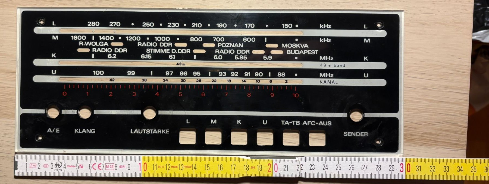

# Gehäuse

Gehäuse aus 8-mm-Dekorplatte Nuss Sizilia. Vom Originalradio bleiben die Frontplatte (300 × 114 × 3 mm) und die beiden geriffelten Lautsprecherabdeckungen (178 × 112 × 7 mm). Abdeckung, Frontplatte und Abdeckung sitzen stumpf nebeneinander, die Abdeckungen stoßen links und rechts an die Seitenwände. Links und rechts ist je eine geschlossene Lautsprecherkammer mit 3 l, in der Mitte das Technikfach.

**Außenmaß: 672 × 138 × 190 mm** (Breite × Höhe × Tiefe), dazu 20 mm Füße.

| Datei | Inhalt |
|---|---|
| `gehaeuse.scad` | 3D-Modell, alle Maße oben als Parameter (OpenSCAD) |
| `zeichnung_gehaeuse.pdf` | Maßzeichnungen, 2 Blätter |
| `zeichnung.py` | erzeugt die Zeichnungen neu, falls sich Maße ändern |
| `bilder/` | Ansichten, Zeichnungen und Foto der Frontplatte |
| `DRUCKTEILE.md` | 3D-Druckteile für das Technikfach, Beleuchtung der Skala, Renderings |
| `traeger.scad`, `stl/` | Modell und Druckdateien der Druckteile |
| `render/` | realistische Renderings (POV-Ray) |

## Material

- **Platten:** [Dekorplatte 8 mm Nuss Sizilia (holzzuschnitt-shop.de)](https://www.holzzuschnitt-shop.de/dekorplatten-in-8-16-19-25-und-38-mm/dekorplatten-8-mm/Nuss-Sizilia-902.html). Die Seite konnte ich nicht öffnen. Beim Bestellen prüfen, ob der Shop passende Kanten (ABS oder Melamin, Nuss Sizilia) mit anbietet oder gleich anleimt. Das spart das Aufbügeln.
- **Chromleisten:** [Alu-Vierkantstange 4 × 4 mm (Amazon)](https://www.amazon.de/dp/B0FKGXWN44), 2 × 0,75 m. Auch diese Seite konnte ich nicht öffnen; laut deinem Screenshot ist es Alloy 6061.

## Aufbau

- **Front:** Das Holz steht 3 mm vor den Abdeckungen. Die Frontplatte ist hinten bündig mit den Abdeckungen und liegt deshalb 4 mm tiefer.
- **Chromleisten:** oben und unten je eine Alu-Vierkantstange 4 × 4 × 656 mm, vorne bündig mit den Abdeckungen, innen an Deckel bzw. Boden geklebt. Für Chromglanz die Sichtseite nass schleifen (Körnung 400 bis 2000) und mit Polierpaste polieren.
- **Frontbretter:** zwei Bretter 200 × 122 mm, je eins hinter einer Abdeckung. Jedes ragt 22 mm hinter die Frontplatte, dort liegt sie auf. Dazwischen bleiben 256 mm frei für Tasten und Drehgeber. 22 mm statt 25 mm, weil die Mitte des A/E-Lochs nur 29,5 mm von der linken Plattenkante entfernt ist (siehe unten).
- **Lautsprecherkammern:** innen 170 × 122 × 164 mm, 3,4 l brutto, **3,0 l netto** nach Abzug von Leisten und Lautsprecher.
- **Technikfach:** 300 × 122 mm innen, 164 mm tief.
- **Rückwände innen eingesetzt:** Deckel, Boden und Seitenwände gehen bis hinten durch, die Rückwände sitzen dazwischen und schließen hinten bündig ab. Sie liegen an Kiefernleisten an.
  - Hinter jeder Kammer ein eingeleimtes Brett 170 × 122 mm. Es schließt die Kammer luftdicht.
  - Hinter dem Technikfach ein magnetischer Deckel 299 × 121 mm (0,5 mm Luft rundum). Vier Neodym-Magnete 10 × 3 mm sitzen bündig in Bohrungen Ø 12 × 4 mm in den Leisten oben und unten, 100 mm links und rechts der Mitte. Auf der Innenseite des Deckels kommen an denselben Stellen Stahlplättchen Ø 10 × 1 mm. Zum Abnehmen greift man ins Griffloch Ø 25 mm. Im Deckel sind auch 21 Lüftungslöcher Ø 10 mm und das Loch für die Netzteilbuchse.
- **Abdeckungen abnehmbar:** je vier Magnete 10 × 3 mm bündig in Bohrungen Ø 12 × 4 mm im Frontbrett, Stahlplättchen auf der Rückseite der Abdeckung. Die Plättchen tauchen in die Bohrungen ein, so liegt die Abdeckung flach auf. Magnetmitten 15 mm von der Außenkante der Abdeckung und 15 mm von der Ober- bzw. Unterkante des Frontbretts. Zum Abnehmen mit dem Fingernagel an der Kante zur Frontplatte ansetzen, dort steht die Abdeckung 4 mm vor.
- **Verbindungen:** In der Kante einer 8-mm-Platte halten weder Dübel noch Schrauben. Alle Ecken sind innen mit Kiefern-Vierkantleisten 15 × 15 mm verleimt.
- **Füße:** 4 Chromfüße Ø 25 mm, 20 mm hoch, 60 mm von der Seite und 55 mm von vorne bzw. hinten. Innen sitzt je ein Klötzchen für die Schraube.

## Frontplatte (aus dem Foto vermessen)

Gemessen am Zollstock im Foto, Genauigkeit etwa ±1 mm. Vor dem 3D-Druck am Original nachmessen.

| Element | Lage (Mitte, waagerecht) | Größe |
|---|---|---|
| Loch A/E | 29,5 mm von links | Ø 10 mm |
| Loch Klang | 54,5 mm von links | Ø 10 mm |
| Loch Lautstärke | ca. 105 mm von links | Ø 10 mm |
| 6 Tastenfenster L, M, K, U, TA-TB, AFC-AUS | ca. 130 bis 240 mm von links | ca. 12,5 × 12,5 mm |
| Loch Sender | 36 mm von rechts | Ø 10,5 mm |
| 4 Befestigungslöcher in den Ecken | ca. 19 mm von links bzw. rechts | ca. Ø 3 mm |

Die vier Befestigungslöcher liegen über den 22 mm breiten Überlappungen der Frontbretter. Die Frontplatte kann dort also mit kurzen Schrauben (z. B. 2,5 × 8) direkt am Frontbrett festgeschraubt werden. Die Lochmitte liegt dann gut 1 mm von der Brettkante entfernt. Das passt, ist aber knapp, deshalb vorher am Original nachmessen.

## Lautsprecher fest eingebaut

Die Rückwand hinter den Kammern ist eingeleimt. Danach kommt man an die Lautsprecher nur noch von vorne heran. Der Korb (110 mm) passt nicht durch das Loch (100 mm), ein Tausch ist dann nicht mehr möglich. Deshalb vor dem Einleimen:

- Kabel anlöten, durch die Zwischenwand ins Technikfach führen, das Loch mit Heißkleber abdichten.
- Die M4-Muttern hinten mit Zweikomponentenkleber am Korb fixieren. So lassen sich die Schrauben von vorne lösen.
- Dämmwolle einlegen.

## Zuschnittliste (8 mm Nuss Sizilia)

| Teil | Anzahl | Maß (mm) | Kanten mit Umleimer |
|---|---|---|---|
| Deckel | 1 | 672 × 190 | vorne, hinten, links, rechts |
| Boden | 1 | 672 × 190 | vorne, hinten, links, rechts |
| Seitenwand | 2 | 190 × 122 | vorne, hinten |
| Frontbrett | 2 | 200 × 122 | – (verdeckt) |
| Zwischenwand | 2 | 172 × 122 | hinten |
| Rückwand Kammer | 2 | 170 × 122 | – |
| Rückwanddeckel Technik | 1 | 299 × 121 | rundum (Kante zählt mit: Maß inkl. Kante) |

Bei Deckel, Boden, Frontbrett und Rückwänden ist die erste Zahl die Breite, bei Seiten- und Zwischenwand die Tiefe. Die Fläche beträgt zusammen etwa 0,47 m², dazu kommen etwa 4,5 m Kante. Wenn der Shop Kanten anleimt, die Maße als Fertigmaße inklusive Kante angeben.

**Kiefer-Vierkantleiste 15 × 15 mm**, zusammen etwa 3 m (3,5 m kaufen):

| Lage | Anzahl | Länge (mm) |
|---|---|---|
| längs in den Ecken Seite/Deckel und Seite/Boden | 4 | 164 |
| längs an den Zwischenwänden oben und unten (Kammerseite) | 4 | 149 |
| hinten senkrecht an Seitenwänden und beidseits der Zwischenwände | 6 | 92 |
| hinten waagerecht im Technikfach (mit Magnetbohrungen) | 2 | 300 |
| hinten waagerecht in den Kammern | 4 | 140 |
| Klötzchen unter den Füßen (ca. 30 × 30 × 10, Reststücke) | 4 | – |

Die hinteren Leisten sitzen 8 mm vor der Hinterkante, damit die Rückwände bündig abschließen.

## Lautsprecher Sharp VSP0010PBS78A

10 cm, 8 Ω, max. 20 W. Korb 110 × 110 mm, vier Löcher Ø 5 mm im Quadrat mit 84 mm Abstand, Blechring innen 100 mm, Bautiefe etwa 47 mm.

- **Ausschnitt im Frontbrett: Ø 100 mm**, 89 mm von der Außenkante des Frontbretts und mittig in der Höhe (61 mm).
- **Befestigung:** vier Löcher Ø 4,5 mm im Quadrat 84 mm, vorne angesenkt. M4 × 20 Senkkopf von vorne, hinten Scheibe und Mutter.
- **Dämmung:** jede Kammer locker zu etwa zwei Dritteln mit Polyesterwatte füllen.

## Zusammenbau

1. Sichtkanten bekleben (falls nicht vom Shop gemacht), bündig abschneiden und schleifen.
2. Frontbretter: Lautsprecherloch, Schraublöcher (angesenkt) und je 4 Magnetbohrungen Ø 12 × 4 mm (Forstnerbohrer mit Tiefenanschlag, nicht durchbohren).
3. Leisten zuschneiden. In die beiden 300-mm-Leisten je 2 Magnetbohrungen Ø 12 × 4 mm in die Rückseite bohren, 100 mm links und rechts der Leistenmitte.
4. Kasten: Seitenwände zwischen Deckel und Boden stellen, Eckleisten längs innen einleimen. Sie beginnen 18 mm hinter der Vorderkante (3 + 7 + 8 mm) und enden 8 mm vor der Hinterkante. Mit Zwingen pressen, Diagonalen prüfen.
5. Frontbretter 10 mm hinter der Vorderkante einleimen, außen an die Seitenwände. Abstandslehre: ein 10 mm breites Holzstück.
6. Zwischenwände einleimen: 170 mm von der Seitenwand-Innenseite, vorne stumpf an das Frontbrett, hinten bündig.
7. Hintere Leisten einleimen, 8 mm vor der Hinterkante. Ein Reststück der 8-mm-Platte als Lehre einlegen.
8. Klötzchen für die Füße innen auf den Boden leimen.
9. Fugen in den Kammern mit Acryl abdichten, Kabelloch Ø 6 mm in jede Zwischenwand.
10. Lautsprecher anschrauben (siehe oben), Kabel durchführen und abdichten, Dämmwolle einlegen.
11. Rückwände der Kammern einleimen.
12. Alu-Vierkantstangen auf 656 mm ablängen, Sichtseite polieren und oben und unten einkleben, Vorderseite 3 mm hinter der Holzkante.
13. Magnete einkleben, Stahlplättchen auflegen, Kleber auf die Plättchen und Abdeckungen bzw. Rückwanddeckel genau positioniert aufdrücken. Nach dem Aushärten abnehmen.
14. Rückwanddeckel: Lüftungslöcher, Griffloch Ø 25 mm und Loch für die Netzteilbuchse bohren.
15. Füße mit Spax 3,5 × 16 durch den Boden in die Klötzchen schrauben.

## Einkaufsliste

- Dekorplatte 8 mm Nuss Sizilia, Zuschnitt nach Liste, Kanten möglichst vom Shop
- Kiefer-Vierkantleiste 15 × 15 mm, ca. 3,5 m
- Alu-Vierkantstange 4 × 4 mm, 2 × 0,75 m; Nassschleifpapier 400–2000, Polierpaste
- 4 Möbelfüße Chrom, ca. Ø 25 mm, 20 mm hoch, zum Anschrauben
- 8 × M4 × 20 Senkkopf mit Muttern und Scheiben
- 12 Neodym-Scheibenmagnete 10 × 3 mm, 12 Stahlplättchen Ø 10 × 1 mm
- Spax 3,5 × 16 (4 Stück)
- Holzleim, Zweikomponentenkleber, Acryl, Heißkleber
- Lochsäge Ø 100 mm, Forstnerbohrer 12 mm und 25 mm, Kegelsenker, Zwingen
- Polyesterwatte, ca. 100 g

Elektronik und Kleinteile für das Technikfach: `../EINKAUF.md`.

## Ist 8 mm zu dünn?

Es geht, liegt aber an der unteren Grenze. Mit den verleimten Leisten wird der Kasten steif genug. Die Kammerwände sind klein und rundum verleimt, mit Dämmwolle schwingen sie kaum hörbar mit. 10 oder 12 mm wären robuster; dafür in `gehaeuse.scad` und `zeichnung.py` nur `t` ändern.

Bilder neu erzeugen: `openscad -o bilder/ansicht_vorne.png gehaeuse.scad` und `python3 zeichnung.py`.
