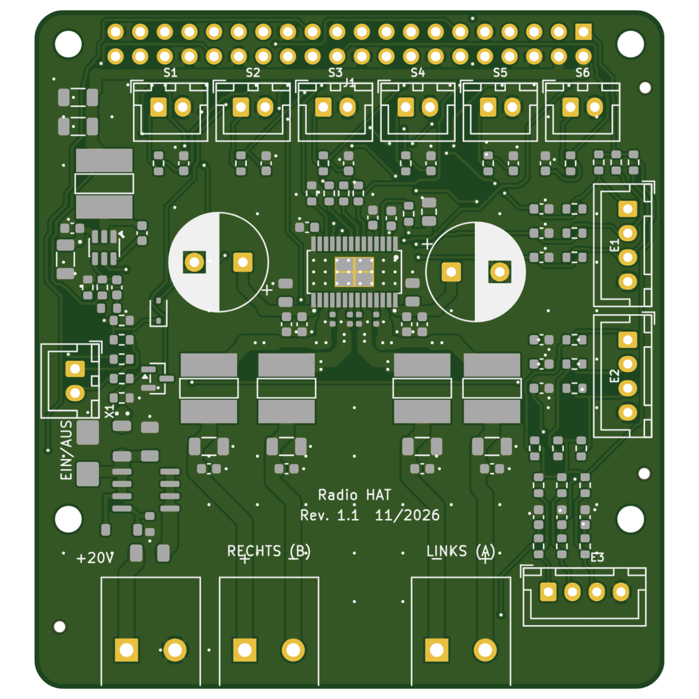

# Radio HAT

Raspberry-Pi-Aufsteckplatine mit Stereo-Verstärker TAS5805M (2 × 19 W an 8 Ω), 5-V-Regler für den Pi, sechs Tasten, drei Drehencodern und Ein/Aus-Schalter.

| Datei | Wofür |
|---|---|
| `JLCPCB/Gerber_RadioHAT.zip` | Platinendaten zum Hochladen bei JLCPCB |
| `JLCPCB/BOM_RadioHAT.csv` | Stückliste für die SMD-Bestückung |
| `JLCPCB/CPL_RadioHAT.csv` | Bauteilpositionen für die SMD-Bestückung |
| `radio_hat_start.sh` | Startskript für den Verstärker auf dem Pi |
| `KiCad/` | Platine als KiCad-Projekt zum Ändern, dazu das Skript für die Bestückungsdatei |
| `PRUEFBERICHT.md` | Was geprüft und geändert wurde, offene Punkte |
| `REICHELT.md` | Bestellliste für die Teile zum Selbstlöten |
| `Bilder/` | Ober- und Unterseite der Platine als Lötvorlage |



Die Bilder zeigen den Stand vom 8.11.2026. Seitdem sind die Beschriftungen E1, E2, E3 und X1 leicht verschoben, C8, C9, C10 und R1 neben dem Verstärker versetzt und die Leiterbahnen zu den Lautsprechern breiter. Die beiden Innenlagen sind auf den Bildern nicht zu sehen.

Die Platine ist neu entworfen und ungetestet. Beim ersten Einschalten keine Lautsprecher anschließen und die Spannungen prüfen (siehe unten).

## Bestellen bei JLCPCB

Dateien im Ordner `JLCPCB`: `Gerber_RadioHAT.zip`, `BOM_RadioHAT.csv`, `CPL_RadioHAT.csv`.

Einstellungen: FR-4, 4 Lagen (Lagenfolge F.Cu, In1.Cu, In2.Cu, B.Cu), 1,6 mm, PCB Qty 5, HASL (with lead). PCB Assembly: Top Side, PCBA Qty 2, Economic, falls das Angebot das für vier Lagen anbietet (nicht geprüft), sonst Standard. Sonst alles auf Standard lassen.

Web-Preis am 8.11.2026: 32,66 € für 5 Platinen, davon 2 mit allen SMD-Teilen bestückt, ohne Versand. Für die Platine zeigte das Angebot einen Desktop-Preis von 1,79 € statt 3,58 €.

In JLCONE: Neues Angebot für Standard PCB/PCBA öffnen, `Gerber_RadioHAT.zip` hochladen, die Einstellungen oben wählen, dann bei der Bestückung `BOM_RadioHAT.csv` und `CPL_RadioHAT.csv` hochladen. Bei „Product Description“ passt „Audio and Video Appliance / Audio Amplifiers“.

Seit dem 16.11.2026 ist die Platine vierlagig (siehe `PRUEFBERICHT.md`). Der Preis oben gilt für den alten zweilagigen Stand; eine vierlagige Platine kostet mehr, den aktuellen Preis zeigt das Angebot.

Vor dem Bezahlen in der Bestückungsvorschau die Drehlage von vier Bauteilen prüfen. Die Platine liegt dabei wie im Bild oben, der 40-polige Sockel oben:

| Bauteil | So muss es aussehen |
|---|---|
| U1 (Verstärker, Mitte) | Pinreihen oben und unten, Pin-1-Punkt oben rechts |
| U2 (5-V-Regler, links) | Pinreihen oben und unten, Pin 1 oben rechts |
| Q1 (Transistor, links) | zwei Pins links, ein Pin rechts |
| D1 (Diode, links) | Kathodenstrich unten |

Liegt ein Bauteil anders, in der Vorschau drehen. Außerdem im BOM-Abgleich prüfen, ob der Verstärker U1 (C478472) lieferbar ist.

## Selbst zu löten

JLCPCB liefert nur die SMD-Teile. Alle Durchsteckteile lötest du selbst ein:

- **Sockel J1:** von der Unterseite einstecken, auf der Oberseite verlöten (40 Lötstellen). Pin 1 liegt rechts oben, weil die Platine um 180° gedreht auf dem Pi sitzt.
- **Elkos C1, C2 (470 µF, mindestens 35 V, 10 mm Durchmesser, 5 mm Raster):** Der Minus-Streifen des Elkos gehört auf die weiß gefüllte Hälfte des Aufdrucks, das lange Bein (+) ins Loch neben dem „+“.
- **JST-Stecker S1–S6, X1, E1–E3:** Die Gehäuse passen genau in die weißen Umrisse.
- **Schraubklemmen J2, J3, J4:** deine eigenen, Raster 5,0 oder 5,08 mm. Die Kabeleinführung zum Platinenrand drehen.

## Einbau neben dem Pi

Die Platine steckt auf dem GPIO-Stecker und zeigt vom Pi weg. Sie überdeckt nur den 7 mm breiten Streifen am Stecker, der Rest liegt neben dem Pi.

- Die beiden oberen Löcher der Platine liegen genau über den zwei Pi-Löchern an der GPIO-Seite. Dort mit M2,5-Abstandshaltern verschrauben. Der Abstand beträgt 11 mm, bei 10-mm-Bolzen also etwa 1 mm mit Unterlegscheiben ausgleichen.
- Die beiden unteren Löcher hängen frei. Dort die Platine im Gehäuse mit eigenen Abstandshaltern stützen, sonst hebelt sie am GPIO-Stecker.

## Vor dem ersten Anstecken der Kabel

Pin 1 ist an jedem Stecker das eckige Lötpad. Beim Encoder-Kabel die Reihenfolge aus der Tabelle unten mit dem gelieferten Stecker vergleichen.

## Netzteil

- 20 V Gleichspannung, 3 A oder mehr (60 bis 65 W).
- Angeschlossen wird es an der Schraubklemme J4 (+ links, − rechts). Das Kabel also abisolieren oder über einen Hohlbuchsen-Adapter mit Schraubklemme führen.
- Polung vor dem ersten Einschalten messen. Die Platine hat keinen Verpolungsschutz.
- Rechnung: Verstärker höchstens 2 × 20 W / 0,88 ≈ 45,5 W, 5-V-Regler für den Pi bis etwa 17 W (3 A am Ausgang), zusammen etwa 62 W.
- Der 5-V-Regler liefert höchstens 3 A. Für einen Pi 4 reicht das, solange keine stromhungrigen USB-Geräte am Pi hängen. Für einen Pi 5 unter Last reicht es nicht.
- Nicht mehr als 26 V anschließen. Der Verstärker ist bis 26,4 V ausgelegt, die Elkos C1 und C2 müssen dafür mindestens 35 V vertragen.
- Den Pi nie gleichzeitig über USB-C versorgen, er bekommt seine 5 V von der Platine.
- Die Lautsprecher haben 8 Ω. Bei 20 V dürfen es nicht weniger als 4,8 Ω sein.

## Steckverbinder

Alle Taster und Encoder schalten gegen GND. Bei S1 bis S6 kommen die Pull-ups vom Pi und müssen in der Software aktiviert werden. Die Encoder haben Pull-ups auf der Platine (siehe unten).

| Stecker | Bauteil | Pin 1 | Pin 2 | Pin 3 | Pin 4 |
|---|---|---|---|---|---|
| S1 | Taste 1 (XH-2) | GPIO17 | GND | | |
| S2 | Taste 2 (XH-2) | GPIO27 | GND | | |
| S3 | Taste 3 (XH-2) | GPIO22 | GND | | |
| S4 | Taste 4 (XH-2) | GPIO23 | GND | | |
| S5 | Taste 5 (XH-2) | GPIO24 | GND | | |
| S6 | Taste 6 (XH-2) | GPIO25 | GND | | |
| E1 | Encoder 1 (XH-4) | A = GPIO5 | B = GPIO6 | Taster = GPIO12 | GND |
| E2 | Encoder 2 (XH-4) | A = GPIO13 | B = GPIO16 | Taster = GPIO26 | GND |
| E3 | Encoder 3 (XH-4) | A = GPIO11 | B = GPIO8 | Taster = GPIO7 | GND |
| X1 | Ein/Aus-Schalter (XH-2) | Schalter | Schalter | | |
| J2 | Lautsprecher rechts | + | − | | |
| J3 | Lautsprecher links | − | + | | |
| J4 | Netzteil 20 V | + | − | | |

## Deine Bauteile

- **Cherry MX Blue (S1 bis S6):** Die zwei Kontakte sind beliebig tauschbar. In der Software 20 ms entprellen.
- **Ein/Aus-Schalter (X1):** Ein rastender Schalter passt. Über ihn fließen nur etwa 2 mA, er liegt nicht im Hauptstromkreis.
- **ALPS STEC11B (E1 bis E3):** A, C, B liegen in einer Reihe, C in der Mitte. Die beiden Tasterkontakte liegen gegenüber. Pin C und ein Tasterkontakt gehen zusammen auf GND (Pin 4), der andere Tasterkontakt auf Pin 3.

Der Encoder verlangt laut Datenblatt mindestens 1 mA an A/B und 10 mA am Taster. Die Platine liefert deshalb 1,2 mA über 2,7 kΩ und 12 mA über 270 Ω aus dem 3,3-V-Pin 1 des Pi.

Beim Encoder ergeben zwei Rastungen einen vollen Impulszyklus. Üblicher Code wie `gpiozero.RotaryEncoder` zählt nur jede zweite Rastung. Das passende Kernel-Overlay in `/boot/firmware/config.txt`, einmal pro Encoder:

```
dtoverlay=rotary-encoder,pin_a=5,pin_b=6,relative_axis=1,steps-per-period=2
dtoverlay=rotary-encoder,pin_a=13,pin_b=16,relative_axis=1,steps-per-period=2
dtoverlay=rotary-encoder,pin_a=11,pin_b=8,relative_axis=1,steps-per-period=2
```

Stimmt die Drehrichtung nicht, A und B im Overlay tauschen. Die Encoder-Taster liegen auf GPIO12, 26 und 7 und brauchen 20 ms Entprellung.

Vom Pi belegt sind außerdem: GPIO2/3 (I²C), GPIO18/19/21 (I²S), GPIO9 (Verstärker-PDN), GPIO10 (Schalter-Erkennung), GPIO4 (Selbsthaltung). Frei bleiben GPIO14, 15 und 20.

## Pi einrichten

```bash
sudo apt install i2c-tools alsa-utils
```

In `/boot/firmware/config.txt` eintragen und neu starten:

```
dtparam=i2c_arm=on
dtparam=i2s=on
dtparam=audio=off
dtoverlay=hifiberry-dac
dtoverlay=gpio-shutdown,gpio_pin=10,active_low=0,gpio_pull=up
dtoverlay=gpio-poweroff,gpiopin=4,active_low=1
```

SPI muss ausgeschaltet bleiben (`dtparam=spi=on` darf nicht aktiv sein), weil GPIO7 bis 11 für Encoder und Verstärker gebraucht werden.

Kontrolle: `i2cdetect -y 1` zeigt `2d` erst, nachdem das Startskript den Verstärker eingeschaltet hat. `aplay -l` zeigt die Karte `sndrpihifiberry`.

Das Skript `radio_hat_start.sh` nach jedem Start einmal ausführen, zum Beispiel über einen systemd-Dienst. Es begrenzt die Ausgangsleistung auf etwa 19 W an 8 Ω.

## So funktioniert der Schalter

- Schalter ein: Der 5-V-Regler startet, der Pi bootet und hält den Regler danach selbst über GPIO4.
- Schalter aus: GPIO10 geht auf high, der Pi fährt sauber herunter und schaltet am Ende GPIO4 ab. Erst dann geht der Regler aus.
- Wird der Pi per Software heruntergefahren, während der Schalter noch auf Ein steht, bleibt der Regler an. Dann einmal aus- und wieder einschalten.

## Erster Test

1. Pi abziehen, keine Lautsprecher anschließen, Netzteil einstecken, Schalter ein.
2. Am 40-poligen Sockel Pin 2 gegen Pin 6 messen: 4,9 bis 5,2 V. Sonst sofort ausschalten.
3. Spannungsfrei machen, Pi aufstecken, booten, `radio_hat_start.sh` starten. Die Fehlerregister müssen 0x00 zeigen.
4. Erst dann Lautsprecher anschließen und mit der voreingestellten Lautstärke (−24 dB) probieren.

Offen und erst am echten Gerät prüfbar: ob der Verstärker nach Pausen ohne I²S-Takt von selbst weiterspielt. Falls nicht, das Startskript erneut ausführen oder dauerhaft einen Stille-Datenstrom laufen lassen.

## KiCad-Projekt

Im Ordner `KiCad` liegt die Platine als `RadioHAT.kicad_pcb` mit Design-Regeln in `RadioHAT.kicad_pro`. Sie wurde aus den Fertigungsdaten vom 8.11.2026 zurückgewonnen, mit allen Netznamen, Bauteilen und Pin-Nummern. Die Dateien im Ordner `JLCPCB` sind aus genau dieser Platine erzeugt.

- Einen Schaltplan gibt es nicht. Änderungen macht man direkt im Platineneditor. „Platine aus Schaltplan aktualisieren“ nicht verwenden.
- Die Datei ist im Format von KiCad 7 gespeichert. KiCad 10 öffnet sie und speichert sie im neuen Format. Nach dem ersten Öffnen einmal die Flächen neu füllen (Taste B) und den DRC starten.
- Der DRC läuft in KiCad 7.0.11 ohne Meldung. Im DRC-Dialog den Abgleich mit dem Schaltplan abgeschaltet lassen. Die Prüfung gegen die Footprint-Bibliothek ist im Projekt abgeschaltet, weil es keine Bibliothek gibt.
- Der Bestückungsdruck besteht aus einzelnen Linien, die Texte sind nicht als Text bearbeitbar. Die Bauteilbezeichner stehen zusätzlich als Text auf der Lage F.Fab.
- Vier Kupferlagen: Oberseite, zwei Masselagen innen (In1.Cu, In2.Cu), Unterseite. Auf In1.Cu liegen außer Masse nur die Doppelbahnen der äußeren Verstärkerausgänge.
- Die vier Masseflächen: Abstand 0,2 mm, Mindestbreite 0,15 mm, Pads voll angebunden, Inseln entfernen.
- Ursprung für Gerber, Bohrdaten und Bestückungsdatei ist die linke untere Platinenecke („Bohr-/Platzierungsursprung verwenden“).

Neue Fertigungsdaten nach einer Änderung:

1. Gerber plotten: F.Cu, In1.Cu, In2.Cu, B.Cu, F.Paste, F.Mask, B.Mask, F.Silkscreen, B.Silkscreen, Edge.Cuts, dazu die Bohrdateien (PTH und NPTH getrennt). Alles in `Gerber_RadioHAT.zip` packen.
2. Bestückungsdatei erzeugen. Das Skript rechnet die Drehwinkel auf die Zählweise von JLCPCB um:

```bash
kicad-cli pcb export pos --format csv --units mm --side front --smd-only --use-drill-file-origin -o pos.csv KiCad/RadioHAT.kicad_pcb
```

```bash
python3 KiCad/jlc_cpl.py pos.csv JLCPCB/CPL_RadioHAT.csv
```

3. Geänderte Bauteilwerte von Hand in `JLCPCB/BOM_RadioHAT.csv` nachtragen.
