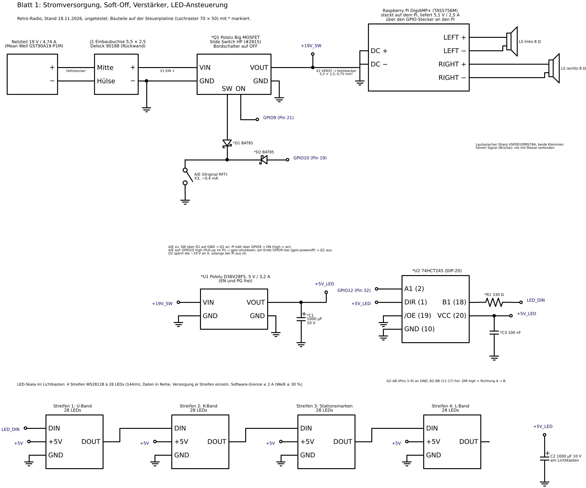
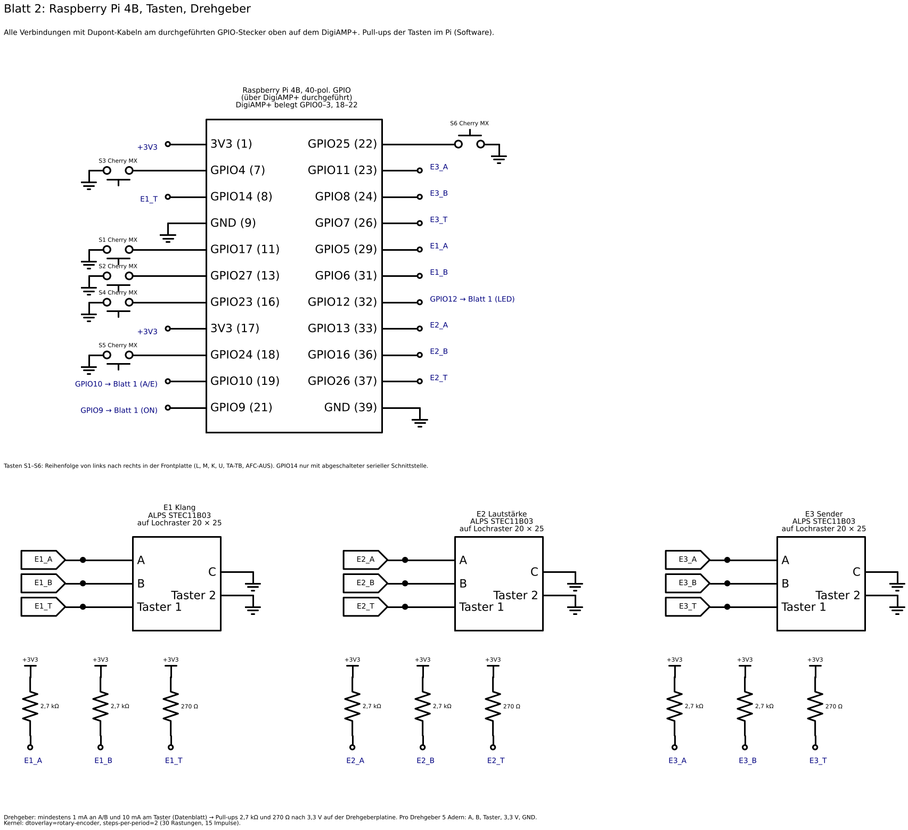

# Retro-Radio

Holzgehäuse mit Frontplatte und Lautsprecherabdeckungen eines DDR-Radios. Innen ein Raspberry Pi 4B mit dem **Raspberry Pi DigiAMP+** als Verstärker, sechs Tasten, drei Drehgebern (nur Drehen), dem Original-A/E-Schalter mit softem Ausschalten und, als Option, einer LED-Skala mit Senderzeiger. Alles zum Bestellen steht in **`EINKAUF.md`**.

Bis zum 17.11.2026 war hier eine eigene Verstärkerplatine (Radio HAT, TAS5805M) entworfen. Sie wird nicht gebaut; der DigiAMP+ macht dasselbe. Der letzte Stand liegt in der Git-Geschichte (Commit `c25365f`), zurückholen mit `git checkout c25365f -- KiCad JLCPCB PRUEFBERICHT.md`.

| Datei | Wofür |
|---|---|
| `Pi/asound.conf` | ALSA-Einstellung: Hochpass 50 Hz vor dem DigiAMP+ |
| `Bilder/digiamp_plus.jpg` | Lageplan des DigiAMP+ aus der Raspberry-Pi-Doku |
| `Schaltplan/` | Schaltplan (`schaltplan.pdf`, `blatt1.png`, `blatt2.png`), erzeugt mit `schaltplan.py` |
| `EINKAUF.md` | vollständige Bestellliste (Elektronik, Kleinteile, Gehäuse) |
| `Gehaeuse/` | Holzgehäuse: 3D-Modell, Maßzeichnungen, Zuschnittliste, Druckteile |

Quellen: [Produktseite](https://www.raspberrypi.com/products/digiamp-plus/), [Doku](https://www.raspberrypi.com/documentation/accessories/audio.html), [pinout.xyz](https://pinout.xyz/pinout/pi_digiamp), Overlay-Beschreibung und Treiber im Raspberry-Pi-Kernel (`overlays/README`, `sound/soc/bcm/iqaudio-dac.c`).

## DigiAMP+ in Kürze

- Verstärker TI TAS5756M (DAC und Endstufe in einem Chip, I²C-Adresse 0x4C), bis 2 × 35 W laut Produktseite. Zwei Schraubklemmen für passive Lautsprecher. Mit Blick von oben und der Netzbuchse links: links „−“, rechts „+“, an beiden Klemmen gleich.
- Versorgung 12 bis 24 V Gleichspannung, 3 A, über Hohlbuchse 5,5 × 2,5 mm (Stecker 2,5 mm innen, 5,5 mm außen, 11 mm lang). Alternativ fest verdrahtet an P5 (Polung beachten).
- Versorgt den Pi über den GPIO-Stecker mit 5,1 V, 2,5 A. **Den Pi nie zusätzlich über seinen eigenen USB-C-Anschluss versorgen.**
- Belegt GPIO2/3 (I²C), GPIO18 bis 21 (I²S), GPIO22 (Stummschaltung und Mute-LED), dazu GPIO0/1 für das HAT-EEPROM.
- 58 × 65 mm, steckt direkt auf dem Pi, Befestigung mit den mitgelieferten Abstandsbolzen auf den vier Pi-Löchern. Deren Außengewinde geht durch den Pi in die gedruckten Säulen des Pi-Halters (Bohrung Ø 2,2, M2,5 schneidet sich selbst ein); gekaufte Abstandshalter braucht es nicht. Liegen keine Bolzen bei: gedruckte Hülsen (11,5 mm) und Schrauben M2,5 × 25 von oben. Der GPIO-Stecker wird nach oben durchgeführt.
- Startet stummgeschaltet (Mute-LED leuchtet). Der Treiber schaltet beim Abspielen ein und 5 s nach dem Ende wieder stumm.
- Betrieb 0 bis 50 °C.
- Lage (Bild in der Doku, GPIO-Stecker oben): Hohlbuchse links unten an der Kante gegenüber dem GPIO-Stecker, rechts daneben die Klemmen LEFT und RIGHT, ganz links P5 (2 Pins, „−“ „+“). Diese Kante liegt über der USB-C/HDMI-Seite des Pi; die Hohlbuchse sitzt auf der Seite von Pin 1 (SD-Karten-Ende).


Bild: Raspberry Pi Ltd., Dokumentation (github.com/raspberrypi/documentation), CC BY-SA 4.0.

## Pi

Raspberry Pi 4B. Die Doku schreibt, der DigiAMP+ sei für Pi 3 und älter ausgelegt; am Pi 4 soll stromhungriges USB-Zubehör an einen USB-Hub mit eigenem Netzteil. Im Radio hängt nichts am USB des Pi: Die (optionale) LED-Skala bekommt ihre 5 V aus einem eigenen Wandler (siehe unten). Der Pi zieht am DigiAMP+ damit nur seine eigenen 0,6 bis 1,3 A von 2,5 A. Der USB-C-Anschluss des Pi bleibt immer frei. Für den Pi einen passiven Kühlkörper aufkleben, er sitzt unter dem DigiAMP+ im geschlossenen Gehäuse.

## Netzteil

Gesucht ist ein geregeltes Tischnetzteil wie bei Laptops:

| Merkmal | Wert |
|---|---|
| Spannung | **19 V** (20 V geht auch) |
| Strom | mindestens 3,42 A (65 W) |
| Stecker | Hohlstecker 5,5 × 2,5 mm, Mitte Plus |
| Art | geregeltes Schaltnetzteil, CE-Zeichen |

Gewählt (Nutzer): **Universal-Laptopnetzteil 90 W** von [Amazon](https://amzn.eu/d/09DU1uIf) (18,5–20 V, 4,74 A, Wechselstecker, Netzkabel dabei). Den Aufsteckstecker 5,5 × 2,5 mm verwenden, vor dem ersten Anschluss mit dem Multimeter prüfen, dass die Mitte Plus ist, und den Stecker mit Schrumpfschlauch gegen Abziehen sichern. Markenalternative: Mean Well GST90A19-P1M (19 V, 4,74 A; Reichelt) mit Netzkabel NKSK 200 SW. Links in `EINKAUF.md`.

- **Warum 19 V:** Die Lautsprecher (Sharp VSP0010PBS78A) haben 8 Ω und vertragen höchstens 20 W. Die Brückenendstufe schafft an 8 Ω höchstens etwa U² / 16 Ω ohne Verluste, bei 19 V also etwa 22 W, real knapp 20 W vor dem Übersteuern; bei 24 V wären es über 30 W. Das gewählte Universalnetzteil liefert 18,5–20 V; bei 20 V sind es real etwa 22 W. Deshalb in der Software die Lautstärke auf etwa −1 dB begrenzen (ALSA „Digital“ höchstens etwa 205 statt 207), dann bleiben die Lautsprecher unter 20 W.
- **Leistung:** Verstärker bei Dauer-Sinus voll aufgedreht bis etwa 45 W, Pi über den DigiAMP+ bis etwa 15 W, LED-Skala (optional) bis 5 W (auf 0,8 A begrenzt, siehe unten). Mit Musik liegt der Mittelwert weit darunter; 65 W reichen.

## Stromversorgung und A/E-Schalter (softes Ausschalten)

Das Netzteil wird hinten am Radio eingesteckt. Der Original-A/E-Schalter (RFT) mit dem Originalknopf bleibt erhalten, schaltet aber nur noch ein Steuersignal von etwa 0,4 mA. Die 19 V schaltet ein fertiges Modul, der **Pololu Big MOSFET Slide Switch MP** (#2814, 4,5–32 V, 4 A Dauerstrom bei 55 °C, Verpolungsschutz, bei Eckstein 6,53 €). Damit ist es egal, wie viel Strom der alte Schalter verträgt.

Welche Variante: Pololu baut das Modul in vier Ausführungen. Mini LV verträgt nur 20 V (zu knapp an 19 V), Mini SV nur 2 A Dauerstrom. MP (4 A) und HP (6 A) haben dieselbe Schaltung, nur andere MOSFETs. Das Radio zieht mit Musik meist unter 1,5 A aus den 19 V; nur bei Dauer-Sinus voll aufgedreht etwa 3,2 A (mit LEDs 3,5 A). Dafür reicht MP. HP wäre nur Reserve und ist bei Eckstein nicht gelistet.

```
Einbaubuchse hinten ──► Pololu MP: VIN      VOUT ──┬──► DC-Kabel mit Hohlstecker ──► DigiAMP+ (19 V) ──► Pi (5,1 V)
                                                     └──► (optional) Pololu D24V10F5 (5 V, 1 A) ──► LED-Skala
                         SW ◄─ BAT85 ─┐
                                      X ── A/E-Schalter ── GND
              Pi GPIO10 ── BAT85 ────┘
              Pi GPIO9  ──────────────► ON
```

So funktioniert es:

- **Einschalten:** A/E zu → X und damit SW auf Masse → das Modul schaltet die 19 V durch → DigiAMP+ und Pi starten. Beim Booten setzt der Pi GPIO9 auf high (Eingang ON des Moduls) und hält sich damit selbst.
- **Ausschalten:** A/E auf → GPIO10 geht über seinen Pull-up auf high → der Pi fährt sauber herunter (`gpio-shutdown`) → ganz am Ende zieht er GPIO9 auf low (`gpio-poweroff`) → das Modul schaltet ab. Dauer etwa 10 bis 20 s; die grüne LED am Modul geht dann aus.
- Die beiden Schottky-Dioden BAT85 trennen die Wege: Solange der Pi über ON selbst hält, sieht GPIO10 trotzdem, ob der Schalter offen ist. Ist der Pi aus, liegen an X etwa 19 V; die Diode zu GPIO10 sperrt dann (BAT85: 30 V).
- **Neustart** (`sudo reboot`) bei geschlossenem Schalter geht normal. `sudo poweroff` bei geschlossenem Schalter hält den Pi nur an, der Strom bleibt an; dann A/E aus- und wieder einschalten. Im Alltag nur mit A/E ausschalten.
- Hängt der Pi einmal, bleibt der Strom an, auch wenn A/E aus ist. Dann den Netzstecker ziehen.
- Ohne Strom vom Netzteil verbraucht das Modul im Aus weniger als 0,2 µA; was im Aus bleibt, ist der Leerlauf des Netzteils.

### Steuerplatine (Lochraster 70 × 50 mm)

Schaltplan: `Schaltplan/schaltplan.pdf` (Blatt 1).



Sitzt im Technikfach rechts neben dem Pi auf dem Druckteil `steuer_halter`. Bauteile und Verbindungen:

| Teil | Anschluss | Verbindung |
|---|---|---|
| Schraubklemme EIN (2-polig, RM 5,08) | + / − | Einbaubuchse hinten (Delock 90188, 9 A, Mittelstift +), 0,75 mm² |
| Pololu Big MOSFET Slide Switch MP | VIN, GND | Klemme EIN |
| | VOUT, GND | Klemme VERST (zum DigiAMP+) und, falls Beleuchtung, VIN des 5-V-Wandlers |
| | SW | Anode der ersten BAT85; Kathode an Punkt X |
| | ON | Pi GPIO9 (Pin 21) |
| | Schiebeschalter auf dem Modul | auf **OFF** stellen, sonst bleibt alles immer an |
| Schraubklemme A/E (2-polig) | X / GND | Original-A/E-Schalter, beliebige Litze |
| zweite BAT85 | Anode Pi GPIO10 (Pin 19), Kathode X | |
| Schraubklemme VERST (2-polig) | + / − | selbst gelötetes Kabel: Silikonlitze 0,75 mm² mit Hohlstecker 5,5 × 2,5 (Lumberg 1634 02) zum DigiAMP+, Mitte + |
| *optional:* Pololu D24V10F5 | VIN, GND, VOUT | VIN an VOUT des Schaltmoduls; VOUT = 5 V für die LEDs. PG frei lassen |
| *optional:* Elko 1000 µF / 10 V | 5 V gegen GND | direkt am 5-V-Ausgang |
| *optional:* 74HCT245 (DIP-20, im Sockel) | 20 = 5 V, 10 = GND, 1 (DIR) = 5 V, 19 (/OE) = GND, 2 (A1) = Pi GPIO12 (Pin 32), 18 (B1) → 330 Ω → LED-Daten | Pins 3–9 an GND, 11–17 frei; 100 nF zwischen 20 und 10 |
| *optional:* Schraubklemme LED (3-polig) | 5 V / Daten / GND | zum Lichtkasten, 3 Adern 0,5 mm² |
| Stiftleiste 1 × 4 | GPIO9, GPIO10, GPIO12 (nur mit Beleuchtung), GND | Dupont-Kabel zum durchgeführten GPIO-Stecker des DigiAMP+ |

Der 74HCT245 hebt das 3,3-V-Datensignal des Pi auf 5-V-Pegel: Er erkennt ab 2,0 V „high“ und gibt volle 5 V aus; WS2812B verlangen mindestens 0,7 × 5 V = 3,5 V. Von den acht Kanälen wird nur einer gebraucht.

### LED-Skala (optional): Aufbau, Strom und Wärme

Die Beleuchtung ist ein Zusatz. Ohne sie fallen weg: Lichtkasten (Druckteil), LED-Streifen, 5-V-Wandler, 74HCT245 mit Sockel, 330 Ω, 100 nF, beide 1000-µF-Elkos, die 3-polige Klemme und die Leitung an GPIO12. Alles andere bleibt gleich; nachrüsten geht jederzeit, wenn auf der Steuerplatine Platz dafür gelassen wird.

- 4 Streifen WS2812B (144 LEDs/m) à 28 LEDs = 112 LEDs, je einer hinter den Schlitzen U, K, L und hinter den Stationsmarken. Daten in Reihe (Ende eines Streifens an den Anfang des nächsten), 5 V und GND an jedem Streifen einzeln vom Klemmenpunkt im Lichtkasten. Am Lichtkasten ein zweiter Elko 1000 µF / 10 V.
- **So leuchten die Sender:** Auf der Frontplatte sind die Stationsmarken kleine durchsichtige Felder (etwa 10 × 3 mm) in zwei Reihen neben den Sendernamen (R. Wolga, Radio DDR, Poznan, Moskva, Stimme d. DDR, Budapest …). Hinter beiden Reihen liegt ein gemeinsamer LED-Streifen in einer eigenen Kammer; der weiße Diffusor verteilt das Licht. Im Grundzustand leuchten alle Marken gleichmäßig wie früher mit der Skalenlampe. Der Senderzeiger ist eine rote LED-Spalte, die in allen vier Reihen an derselben Stelle leuchtet. Weil eine Marke 10 mm breit ist und die LEDs 6,9 mm Abstand haben, liegen hinter jeder Marke ein bis zwei eigene LEDs. Die Software kann also zusätzlich die Marke des eingestellten Senders heller oder in einer anderen Farbe leuchten lassen. Dazu muss nur die Lage jeder Marke (in mm ab linker Plattenkante) einmal ausgemessen werden. Eine Marke der oberen und eine der unteren Reihe an derselben Stelle leuchten immer zusammen.
- **Strom:** Jede LED zieht bei vollem Weiß bis 60 mA, alle zusammen 6,7 A; dazu etwa 1 mA je LED in Ruhe (0,11 A). Der Pololu D24V10F5 liefert 1 A. **In der Software auf 0,8 A begrenzen**: Weiß höchstens 10 %, Warmweiß bis etwa 15 %. Als Skalenlicht reicht das. Wer heller will, nimmt den D36V28F5 (3,2 A, bei Eckstein 26,12 €) und begrenzt auf 2 A.
- **Wärme:** 4 W im PLA-Lichtkasten sind unkritisch.
- Früher geplant war ein RP2040-Zero am USB des Pi. Das hätte bis zu 1,2 A zusätzlich über den 5-V-Regler des DigiAMP+ gezogen, der für Pi und USB zusammen nur 2,5 A hat. Jetzt kommt der Strom aus dem eigenen Wandler, und die Daten kommen direkt vom Pi (PWM an GPIO12, Bibliothek `rpi_ws281x`).

## Anschlüsse an den Pi



Alles kommt mit Dupont-Kabeln (Buchse) an den durchgeführten GPIO-Stecker oben auf dem DigiAMP+. Tasten und Drehgeber schalten gegen GND.

| Bauteil | GPIO | Pin |
|---|---|---|
| Taste 1 | GPIO17 | 11 |
| Taste 2 | GPIO27 | 13 |
| Taste 3 | GPIO4 | 7 |
| Taste 4 | GPIO23 | 16 |
| Taste 5 | GPIO24 | 18 |
| Taste 6 | GPIO25 | 22 |
| Drehgeber Klang (A, B) | GPIO5, GPIO6 | 29, 31 |
| Drehgeber Lautstärke (A, B) | GPIO13, GPIO16 | 33, 36 |
| Drehgeber Sender (A, B) | GPIO11, GPIO8 | 23, 24 |
| A/E-Schalter lesen (über BAT85) | GPIO10 | 19 |
| Selbsthaltung (ON des Schaltmoduls) | GPIO9 | 21 |
| LED-Daten (über 74HCT245, optional) | GPIO12 | 32 |
| 3,3 V für die Pull-ups der Drehgeber | – | 1 oder 17 |
| GND | – | 6, 9, 14, 20, 25, 30, 34, 39 |

Vom DigiAMP+ belegt: GPIO0/1, 2/3, 18 bis 21, 22. Frei bleiben GPIO7, 14, 15 und 26 (Pins 26, 8, 10, 37). Geändert gegenüber dem Entwurf mit eigener Platine: Taste 3 von GPIO22 auf GPIO4; Drehgeber ohne Taster.

- **Tasten (Cherry MX Blue):** Pull-ups im Pi, in der Software einschalten, 20 ms entprellen.
- **Drehgeber (ALPS STEC12E07, 24 Rastungen, 24 Impulse, ohne Taster):** 12-mm-Bauform zum Einschnappen in die Platine, Welle Ø 6 abgeflacht (laut Reichelt 10 mm lang). Pins A, C, B im Raster 2,5 mm passen ins Lochraster; für die zwei Haltelaschen die Löcher auf Ø 2 aufbohren. Belastbarkeit laut Datenblatt 0,5 mA bei 5 V. Die Pull-ups im Pi (etwa 50 kΩ, 0,07 mA) sind für Dauerbetrieb knapp; deshalb auf jede Lochrasterplatine zwei Widerstände: 10 kΩ von A nach 3,3 V und 10 kΩ von B nach 3,3 V (je 0,33 mA). Pin C (Mitte) an GND. Pro Drehgeber ein Kabel mit 4 Adern: A, B, 3,3 V, GND.

```
          Drehgeber, Pins von hinten:   A    C    B
                                        │    │    │
   Pi GPIO (A) ◄────────────────────────┤    │    ├────────────────────────► Pi GPIO (B)
                                      10 kΩ  │  10 kΩ
                                        │    │    │
   Pi 3,3 V (Pin 1/17) ─────────────────┴────┼────┘
   Pi GND ───────────────────────────────────┘
```

## Pi einrichten

Den DigiAMP+ (grüne Ausführung) aufstecken und verschrauben, Lautsprecher anklemmen, Strom ein. Der Pi startet mit.

Erkennung prüfen:

```bash
grep -a . /proc/device-tree/hat/*
```

Dort muss „Raspberry Pi Ltd.“ stehen. Das HAT-EEPROM lädt den Treiber dann von selbst. Nur wenn nichts erkannt wird, in `/boot/firmware/config.txt` eintragen:

```
dtoverlay=
dtoverlay=rpi-digiampplus
```

Außerdem in `/boot/firmware/config.txt`:

```
dtparam=audio=off
dtoverlay=gpio-shutdown,gpio_pin=10,active_low=0,gpio_pull=up,debounce=200
dtoverlay=gpio-poweroff,gpiopin=9,active_low=1
dtoverlay=rotary-encoder,pin_a=5,pin_b=6,relative_axis=1,steps-per-period=4
dtoverlay=rotary-encoder,pin_a=13,pin_b=16,relative_axis=1,steps-per-period=4
dtoverlay=rotary-encoder,pin_a=11,pin_b=8,relative_axis=1,steps-per-period=4
```

und die vorhandene Zeile `dtoverlay=vc4-kms-v3d` zu `dtoverlay=vc4-kms-v3d,noaudio` ändern. Dann ist der DigiAMP+ die einzige Soundkarte (Karte 0).

- `24db_digital_gain` **nicht** setzen. Ohne diesen Schalter lässt der Treiber die Lautstärke („Digital“) höchstens bis 0 dB zu; darüber würde laute Musik übersteuert.
- SPI ausgeschaltet lassen (`dtparam=spi=on` darf nicht aktiv sein), weil GPIO8 und 11 für den Drehgeber Sender gebraucht werden.
- `gpio-shutdown` an GPIO10: Öffnen des A/E-Schalters (GPIO10 wird high) fährt den Pi herunter. `gpio-poweroff` an GPIO9 mit `active_low`: GPIO9 ist im Betrieb high und geht am Ende des Herunterfahrens (und bei jedem Neustart kurz) auf low; dann schaltet das Pololu-Modul ab, sofern A/E offen ist.
- Die alten Einträge der eigenen Platine (`hifiberry-dac`, `gpio-poweroff,gpiopin=4`) dürfen nicht mehr drinstehen; GPIO4 ist jetzt Taste 3.
- Beim STEC12E07 ergibt jede Rastung einen vollen Impulszyklus, daher `steps-per-period=4`. Stimmt die Drehrichtung nicht, A und B tauschen.

Neu starten und prüfen:

```bash
aplay -l
```

zeigt Karte 0 „RPi DigiAMP+“.

Hochpass einrichten (optional, empfohlen für die kleinen Lautsprecher):

```bash
sudo apt install libasound2-plugins swh-plugins alsa-utils
```

```bash
sudo install -m 644 Pi/asound.conf /etc/asound.conf
```

Grundlautstärke setzen und speichern:

```bash
amixer -c 0 sset Digital -- -24dB
```

```bash
sudo alsactl store
```

Eigene Programme stellen die Lautstärke über das ALSA-Element „Digital“ ein (in MPD: `mixer_type "hardware"`, `mixer_control "Digital"`).

LED-Skala (falls eingebaut): Bibliothek `rpi_ws281x` (Python: `sudo pip3 install rpi_ws281x --break-system-packages`), PWM-Kanal 0 an GPIO12, 112 LEDs, Typ GRB, Programm als root. Helligkeit im Programm fest begrenzen (siehe „LED-Skala: Strom und Wärme“). Die PWM ist frei, weil der analoge Audioausgang mit `dtparam=audio=off` aus ist.

## Erster Test

1. Steuerplatine ohne Pi, DigiAMP+ und LEDs: Netzteil hinten einstecken. A/E aus: grüne LED am Modul aus, 0 V an VERST. A/E ein: LED an, am Hohlstecker des Kabels zum DigiAMP+ innen +19 bis +20 V, außen Minus; am 5-V-Ausgang (falls Beleuchtung) 4,8 bis 5,2 V.
2. Lautsprecher abklemmen, DigiAMP+ auf den Pi, Hohlstecker und Dupont-Kabel (GPIO9, 10, 12, GND) stecken, A/E ein. Power-LED am DigiAMP+ an, Mute-LED an.
3. Pi bootet. `aplay -l` zeigt „RPi DigiAMP+“.
4. Lautsprecher anklemmen. `speaker-test -c 2 -t wav` spielt abwechselnd links und rechts; die Mute-LED geht beim Abspielen aus.
5. Hochpass prüfen: `speaker-test -c 2 -t sine -f 30` muss deutlich leiser sein als `-f 100`.
6. Ohne Musik das Ohr an den Lautsprecher halten: kein Brummen oder Zirpen.
7. A/E aus: Der Pi fährt herunter, nach 10 bis 20 s geht die grüne LED am Modul aus. A/E wieder ein: Der Pi startet.
8. Falls Beleuchtung: LED-Skala zuerst mit 5 % Helligkeit testen, Strom am 5-V-Ausgang messen (höchstens 0,8 A).
