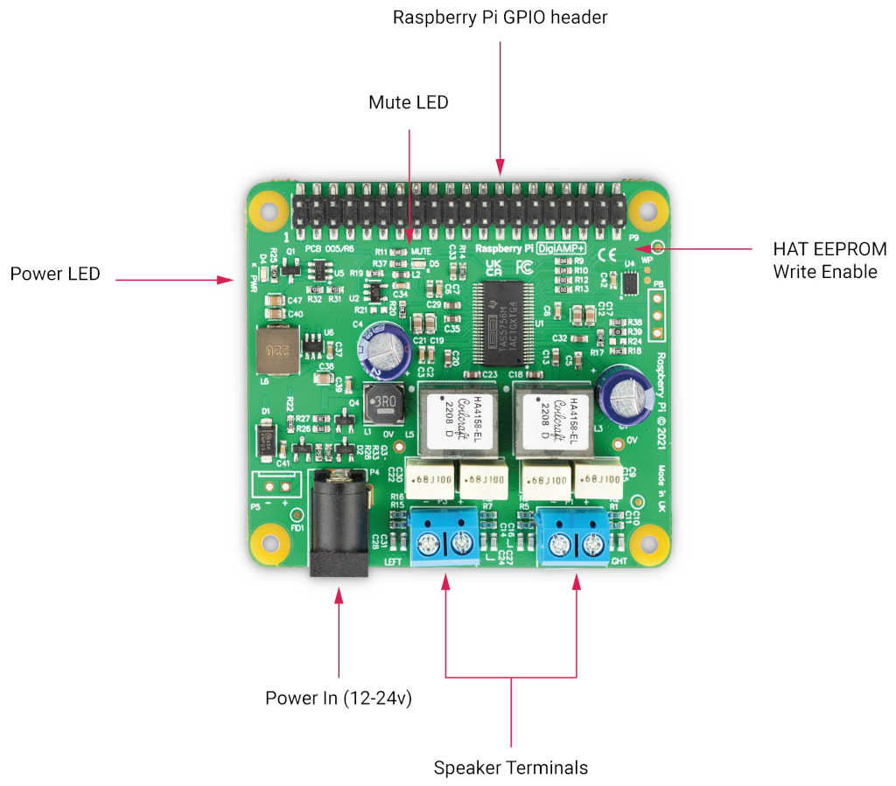

# Retro-Radio

Holzgehäuse mit Frontplatte und Lautsprecherabdeckungen eines DDR-Radios. Innen ein Raspberry Pi 4B mit dem **Raspberry Pi DigiAMP+** als Verstärker, sechs Tasten, drei Drehgebern, dem Original-A/E-Schalter mit softem Ausschalten und einer LED-Skala mit Senderzeiger. Alles zum Bestellen steht in **`EINKAUF.md`**.

Bis zum 17.11.2026 war hier eine eigene Verstärkerplatine (Radio HAT, TAS5805M) entworfen. Sie wird nicht gebaut; der DigiAMP+ macht dasselbe. Der letzte Stand liegt in der Git-Geschichte (Commit `c25365f`), zurückholen mit `git checkout c25365f -- KiCad JLCPCB PRUEFBERICHT.md`.

| Datei | Wofür |
|---|---|
| `Pi/asound.conf` | ALSA-Einstellung: Hochpass 50 Hz vor dem DigiAMP+ |
| `Bilder/digiamp_plus.jpg` | Lageplan des DigiAMP+ aus der Raspberry-Pi-Doku |
| `EINKAUF.md` | vollständige Bestellliste (Elektronik, Kleinteile, Gehäuse) |
| `Gehaeuse/` | Holzgehäuse: 3D-Modell, Maßzeichnungen, Zuschnittliste, Druckteile |

Quellen: [Produktseite](https://www.raspberrypi.com/products/digiamp-plus/), [Doku](https://www.raspberrypi.com/documentation/accessories/audio.html), [pinout.xyz](https://pinout.xyz/pinout/pi_digiamp), Overlay-Beschreibung und Treiber im Raspberry-Pi-Kernel (`overlays/README`, `sound/soc/bcm/iqaudio-dac.c`).

## DigiAMP+ in Kürze

- Verstärker TI TAS5756M (DAC und Endstufe in einem Chip, I²C-Adresse 0x4C), bis 2 × 35 W laut Produktseite. Zwei Schraubklemmen für passive Lautsprecher. Mit Blick von oben und der Netzbuchse links: links „−“, rechts „+“, an beiden Klemmen gleich.
- Versorgung 12 bis 24 V Gleichspannung, 3 A, über Hohlbuchse 5,5 × 2,5 mm (Stecker 2,5 mm innen, 5,5 mm außen, 11 mm lang). Alternativ fest verdrahtet an P5 (Polung beachten).
- Versorgt den Pi über den GPIO-Stecker mit 5,1 V, 2,5 A. **Den Pi nie zusätzlich über seinen eigenen USB-C-Anschluss versorgen.**
- Belegt GPIO2/3 (I²C), GPIO18 bis 21 (I²S), GPIO22 (Stummschaltung und Mute-LED), dazu GPIO0/1 für das HAT-EEPROM.
- 58 × 65 mm, steckt direkt auf dem Pi, Befestigung mit den mitgelieferten Abstandsbolzen auf den vier Pi-Löchern. Der GPIO-Stecker wird nach oben durchgeführt.
- Startet stummgeschaltet (Mute-LED leuchtet). Der Treiber schaltet beim Abspielen ein und 5 s nach dem Ende wieder stumm.
- Betrieb 0 bis 50 °C.
- Lage (Bild in der Doku, GPIO-Stecker oben): Hohlbuchse links unten an der Kante gegenüber dem GPIO-Stecker, rechts daneben die Klemmen LEFT und RIGHT, ganz links P5 (2 Pins, „−“ „+“). Diese Kante liegt über der USB-C/HDMI-Seite des Pi; die Hohlbuchse sitzt auf der Seite von Pin 1 (SD-Karten-Ende).



Bild: Raspberry Pi Ltd., Dokumentation (github.com/raspberrypi/documentation), CC BY-SA 4.0.

## Pi

Raspberry Pi 4B. Die Doku schreibt, der DigiAMP+ sei für Pi 3 und älter ausgelegt; am Pi 4 soll stromhungriges USB-Zubehör an einen USB-Hub mit eigenem Netzteil. Im Radio hängt nichts am USB des Pi: Die LED-Skala bekommt ihre 5 V aus einem eigenen Wandler (siehe unten). Der Pi zieht am DigiAMP+ damit nur seine eigenen 0,6 bis 1,3 A von 2,5 A. Der USB-C-Anschluss des Pi bleibt immer frei. Für den Pi einen passiven Kühlkörper aufkleben, er sitzt unter dem DigiAMP+ im geschlossenen Gehäuse.

## Netzteil

Gesucht ist ein geregeltes Tischnetzteil wie bei Laptops:

| Merkmal | Wert |
|---|---|
| Spannung | **19 V** (20 V geht auch) |
| Strom | mindestens 3,42 A (65 W) |
| Stecker | Hohlstecker 5,5 × 2,5 mm, Mitte Plus |
| Art | geregeltes Schaltnetzteil, CE-Zeichen |

Empfehlung von Raspberry Pi: **XP Power VEC65US19** (19 V, 3,42 A, 65 W, Stecker 5,5 × 2,5 × 11 mm Mitte Plus, Eingang 90–264 V). Das Netzkabel wird laut Händlern separat verkauft; vor dem Kauf nachsehen, welche Buchse das Netzteil hat (C6, C8 oder C14), und das passende Kabel mitbestellen. Ein gleichwertiges 19-V-Laptopnetzteil mit 5,5 × 2,5 mm tut es genauso.

- **Warum 19 V:** Die Lautsprecher (Sharp VSP0010PBS78A) haben 8 Ω und vertragen höchstens 20 W. Die Brückenendstufe schafft an 8 Ω höchstens etwa U² / 16 Ω ohne Verluste, bei 19 V also etwa 22 W, real knapp 20 W vor dem Übersteuern; bei 24 V wären es über 30 W.
- **Leistung:** Verstärker bei Dauer-Sinus voll aufgedreht bis etwa 45 W, Pi über den DigiAMP+ bis etwa 15 W, LED-Skala bis 12 W (auf 2 A begrenzt, siehe unten). Mit Musik liegt der Mittelwert weit darunter; 65 W reichen.

## Stromversorgung und A/E-Schalter (softes Ausschalten)

Das Netzteil wird hinten am Radio eingesteckt. Der Original-A/E-Schalter (RFT) mit dem Originalknopf bleibt erhalten, schaltet aber nur noch ein Steuersignal von etwa 0,4 mA. Die 19 V schaltet ein fertiges Modul, der **Pololu Big MOSFET Slide Switch HP** (#2815, 4,5–32 V, 6 A Dauerstrom, Verpolungsschutz). Damit ist es egal, wie viel Strom der alte Schalter verträgt.

```
Einbaubuchse hinten ──► Pololu HP: VIN      VOUT ──┬──► DC-Kabel mit Hohlstecker ──► DigiAMP+ (19 V) ──► Pi (5,1 V)
                                                     └──► Pololu D36V28F5 (5 V, 3,2 A) ──► LED-Skala
                         SW ◄─ BAT85 ─┐
                                      X ── A/E-Schalter ── GND
              Pi GPIO10 ── BAT85 ────┘
              Pi GPIO9  ──────────────► ON
```

So funktioniert es:

- **Einschalten:** A/E zu → X und damit SW auf Masse → das Modul schaltet die 19 V durch → DigiAMP+ und Pi starten. Beim Booten setzt der Pi GPIO9 auf high (Eingang ON des Moduls) und hält sich damit selbst.
- **Ausschalten:** A/E auf → GPIO10 geht über seinen Pull-up auf high → der Pi fährt sauber herunter (`gpio-shutdown`) → ganz am Ende zieht er GPIO9 auf low (`gpio-poweroff`) → das Modul schaltet ab. Dauer etwa 10 bis 20 s; die grüne LED am Modul geht dann aus.
- Die beiden Schottky-Dioden BAT85 trennen die Wege: Solange der Pi über ON selbst hält, sieht GPIO10 trotzdem, ob der Schalter offen ist. Ist der Pi aus, liegen an X etwa 19 V; die Diode zu GPIO10 sperrt dann (BAT85: 30 V).
- **Neustart** (`sudo reboot`) bei geschlossenem Schalter geht normal. `sudo poweroff` bei geschlossenem Schalter hält den Pi nur an, der Strom bleibt an; dann A/E aus- und wieder einschalten. Im Alltag nur mit A/E ausschalten.
- Hängt der Pi einmal, bleibt der Strom an, auch wenn A/E aus ist. Dann den Netzstecker ziehen.
- Ohne Strom vom Netzteil verbraucht das Modul im Aus weniger als 0,2 µA; was im Aus bleibt, ist der Leerlauf des Netzteils.
- Wackelt der alte Schalter bei dem kleinen Strom (oxidierte Kontakte), mit Kontaktspray behandeln und ein paarmal durchschalten.

### Steuerplatine (Lochraster 70 × 50 mm)

Sitzt im Technikfach rechts neben dem Pi auf dem Druckteil `steuer_halter`. Bauteile und Verbindungen:

| Teil | Anschluss | Verbindung |
|---|---|---|
| Schraubklemme EIN (2-polig, RM 5,08) | + / − | Einbaubuchse hinten (Mittelstift +), 0,75 mm² |
| Pololu Big MOSFET Slide Switch HP | VIN, GND | Klemme EIN |
| | VOUT, GND | Klemme VERST (zum DigiAMP+) und VIN des 5-V-Wandlers |
| | SW | Anode der ersten BAT85; Kathode an Punkt X |
| | ON | Pi GPIO9 (Pin 21) |
| | Schiebeschalter auf dem Modul | auf **OFF** stellen, sonst bleibt alles immer an |
| Schraubklemme A/E (2-polig) | X / GND | Original-A/E-Schalter, beliebige Litze |
| zweite BAT85 | Anode Pi GPIO10 (Pin 19), Kathode X | |
| Schraubklemme VERST (2-polig) | + / − | DC-Kabel mit Hohlstecker 5,5 × 2,5 zum DigiAMP+ (Mitte +), 0,75 mm² |
| Pololu D36V28F5 | VIN, GND, VOUT | VIN an VOUT des Schaltmoduls; VOUT = 5 V für die LEDs. EN und PG frei lassen |
| Elko 1000 µF / 10 V | 5 V gegen GND | direkt am 5-V-Ausgang |
| 74AHCT125 (DIP-14, im Sockel) | 14 = 5 V, 7 = GND, 1 = GND, 2 = Pi GPIO12 (Pin 32), 3 → 330 Ω → LED-Daten | Pins 4, 10, 13 an 5 V; 5, 9, 12 an GND; 100 nF zwischen 14 und 7 |
| Schraubklemme LED (3-polig) | 5 V / Daten / GND | zum Lichtkasten, 3 Adern 0,5 mm² |
| Stiftleiste 1 × 4 | GPIO9, GPIO10, GPIO12, GND | Dupont-Kabel zum durchgeführten GPIO-Stecker des DigiAMP+ |

Der 74AHCT125 hebt das 3,3-V-Datensignal des Pi auf 5-V-Pegel; WS2812B verlangen mindestens 0,7 × 5 V = 3,5 V.

### LED-Skala: Strom und Wärme

- 4 Streifen WS2812B (144 LEDs/m) à 28 LEDs = 112 LEDs, Daten in Reihe (Ende eines Streifens an den Anfang des nächsten), 5 V und GND an jedem Streifen einzeln vom Klemmenpunkt im Lichtkasten. Am Lichtkasten ein zweiter Elko 1000 µF / 10 V.
- Jede LED zieht bei vollem Weiß bis 60 mA, alle zusammen 6,7 A; dazu etwa 1 mA je LED in Ruhe. Der D36V28F5 liefert 2,5 bis 4 A. **In der Software die Helligkeit begrenzen**, sodass höchstens 2 A fließen (Weiß höchstens 30 %). Als Skalenlicht reichen 10 bis 15 % (etwa 0,5 bis 1 A, 2,5 bis 5 W).
- Wärme: 5 W im PLA-Lichtkasten sind unkritisch; dauerhaft über 10 W würde PLA weich. Wer heller will, druckt den Lichtkasten aus PETG.
- Vorher (Entwurf v1) sollte ein RP2040-Zero am USB des Pi die LEDs steuern und versorgen. Das hätte bis zu 1,2 A zusätzlich über den 5-V-Regler des DigiAMP+ gezogen, der nur 2,5 A für Pi und USB zusammen hat. Jetzt kommt der Strom aus dem eigenen Wandler, und die Daten kommen direkt vom Pi (PWM an GPIO12, Bibliothek `rpi_ws281x`). Der RP2040 entfällt.

## Anschlüsse an den Pi

Alles kommt mit Dupont-Kabeln (Buchse) an den durchgeführten GPIO-Stecker oben auf dem DigiAMP+. Tasten und Drehgeber schalten gegen GND.

| Bauteil | GPIO | Pin |
|---|---|---|
| Taste 1 | GPIO17 | 11 |
| Taste 2 | GPIO27 | 13 |
| Taste 3 | GPIO4 | 7 |
| Taste 4 | GPIO23 | 16 |
| Taste 5 | GPIO24 | 18 |
| Taste 6 | GPIO25 | 22 |
| Drehgeber Klang (A, B, Taster) | GPIO5, GPIO6, GPIO14 | 29, 31, 8 |
| Drehgeber Lautstärke (A, B, Taster) | GPIO13, GPIO16, GPIO26 | 33, 36, 37 |
| Drehgeber Sender (A, B, Taster) | GPIO11, GPIO8, GPIO7 | 23, 24, 26 |
| A/E-Schalter lesen (über BAT85) | GPIO10 | 19 |
| Selbsthaltung (ON des Schaltmoduls) | GPIO9 | 21 |
| LED-Daten (über 74AHCT125) | GPIO12 | 32 |
| 3,3 V für die Pull-ups der Drehgeber | – | 1 oder 17 |
| GND | – | 6, 9, 14, 20, 25, 30, 34, 39 |

Vom DigiAMP+ belegt: GPIO0/1, 2/3, 18 bis 21, 22. Frei bleibt nur GPIO15 (Pin 10). Geändert gegenüber dem Entwurf mit eigener Platine: Taste 3 von GPIO22 auf GPIO4, Taster des Drehgebers Klang von GPIO12 auf GPIO14 (GPIO12 ist der einzige freie PWM-Pin für die LEDs).

- **Tasten (Cherry MX Blue):** Pull-ups im Pi, in der Software einschalten, 20 ms entprellen.
- **Drehgeber (ALPS STEC11B03, 30 Rastungen, 15 Impulse, mit Taster):** Der Drehgeber verlangt laut Datenblatt mindestens 1 mA an A/B und 10 mA am Taster; die Pull-ups im Pi (etwa 50 kΩ) liefern nur rund 0,07 mA. Deshalb auf jede Lochrasterplatine der Drehgeber drei Widerstände löten: 2,7 kΩ von A und von B nach 3,3 V (1,2 mA), 270 Ω vom Taster nach 3,3 V (12 mA). Pin C und ein Tasterkontakt an GND. Pro Drehgeber ein Kabel mit 5 Adern: A, B, Taster, 3,3 V, GND.

## Pi einrichten

Den DigiAMP+ (grüne Ausführung) aufstecken und verschrauben, Lautsprecher anklemmen, Strom ein. Der Pi startet mit.

Erkennung prüfen:

```bash
grep -a . /proc/device-tree/hat/*
```

Dort muss „Raspberry Pi Ltd.“ stehen. Das HAT-EEPROM lädt den Treiber dann von selbst. Nur wenn nichts erkannt wird, in `/boot/firmware/config.txt` eintragen:

```
dtoverlay=
dtoverlay=rpi-digiampplus
```

Außerdem in `/boot/firmware/config.txt`:

```
dtparam=audio=off
dtoverlay=gpio-shutdown,gpio_pin=10,active_low=0,gpio_pull=up,debounce=200
dtoverlay=gpio-poweroff,gpiopin=9,active_low=1
dtoverlay=rotary-encoder,pin_a=5,pin_b=6,relative_axis=1,steps-per-period=2
dtoverlay=rotary-encoder,pin_a=13,pin_b=16,relative_axis=1,steps-per-period=2
dtoverlay=rotary-encoder,pin_a=11,pin_b=8,relative_axis=1,steps-per-period=2
```

und die vorhandene Zeile `dtoverlay=vc4-kms-v3d` zu `dtoverlay=vc4-kms-v3d,noaudio` ändern. Dann ist der DigiAMP+ die einzige Soundkarte (Karte 0).

- `24db_digital_gain` **nicht** setzen. Ohne diesen Schalter lässt der Treiber die Lautstärke („Digital“) höchstens bis 0 dB zu; darüber würde laute Musik übersteuert.
- SPI ausgeschaltet lassen (`dtparam=spi=on` darf nicht aktiv sein), weil GPIO7, 8 und 11 für Drehgeber 3 gebraucht werden.
- `gpio-shutdown` an GPIO10: Öffnen des A/E-Schalters (GPIO10 wird high) fährt den Pi herunter. `gpio-poweroff` an GPIO9 mit `active_low`: GPIO9 ist im Betrieb high und geht am Ende des Herunterfahrens (und bei jedem Neustart kurz) auf low; dann schaltet das Pololu-Modul ab, sofern A/E offen ist.
- Serielle Schnittstelle aus, weil GPIO14 ein Drehgeber-Taster ist: `sudo raspi-config` → Interface Options → Serial Port → Login-Shell **nein**, Hardware **nein**.
- Die alten Einträge der eigenen Platine (`hifiberry-dac`, `gpio-poweroff,gpiopin=4`) dürfen nicht mehr drinstehen; GPIO4 ist jetzt Taste 3.
- Beim Drehgeber ergeben zwei Rastungen einen vollen Impulszyklus, daher `steps-per-period=2`. Stimmt die Drehrichtung nicht, A und B tauschen.

Neu starten und prüfen:

```bash
aplay -l
```

zeigt Karte 0 „RPi DigiAMP+“.

Hochpass einrichten (optional, empfohlen für die kleinen Lautsprecher):

```bash
sudo apt install libasound2-plugins swh-plugins alsa-utils
```

```bash
sudo install -m 644 Pi/asound.conf /etc/asound.conf
```

Grundlautstärke setzen und speichern:

```bash
amixer -c 0 sset Digital -- -24dB
```

```bash
sudo alsactl store
```

Eigene Programme stellen die Lautstärke über das ALSA-Element „Digital“ ein (in MPD: `mixer_type "hardware"`, `mixer_control "Digital"`).

LED-Skala: Bibliothek `rpi_ws281x` (Python: `sudo pip3 install rpi_ws281x --break-system-packages`), PWM-Kanal 0 an GPIO12, 112 LEDs, Typ GRB, Programm als root. Helligkeit im Programm fest begrenzen (siehe „LED-Skala: Strom und Wärme“). Die PWM ist frei, weil der analoge Audioausgang mit `dtparam=audio=off` aus ist.

## Erster Test

1. Steuerplatine ohne Pi, DigiAMP+ und LEDs: Netzteil hinten einstecken. A/E aus: grüne LED am Modul aus, 0 V an VERST. A/E ein: LED an, am Hohlstecker des Kabels zum DigiAMP+ innen +19 V, außen Minus; am 5-V-Ausgang 4,8 bis 5,2 V.
2. Lautsprecher abklemmen, DigiAMP+ auf den Pi, Hohlstecker und Dupont-Kabel (GPIO9, 10, 12, GND) stecken, A/E ein. Power-LED am DigiAMP+ an, Mute-LED an.
3. Pi bootet. `aplay -l` zeigt „RPi DigiAMP+“.
4. Lautsprecher anklemmen. `speaker-test -c 2 -t wav` spielt abwechselnd links und rechts; die Mute-LED geht beim Abspielen aus.
5. Hochpass prüfen: `speaker-test -c 2 -t sine -f 30` muss deutlich leiser sein als `-f 100`.
6. Ohne Musik das Ohr an den Lautsprecher halten: kein Brummen oder Zirpen.
7. A/E aus: Der Pi fährt herunter, nach 10 bis 20 s geht die grüne LED am Modul aus. A/E wieder ein: Der Pi startet.
8. LED-Skala zuerst mit 5 % Helligkeit testen, Strom am 5-V-Ausgang messen.
